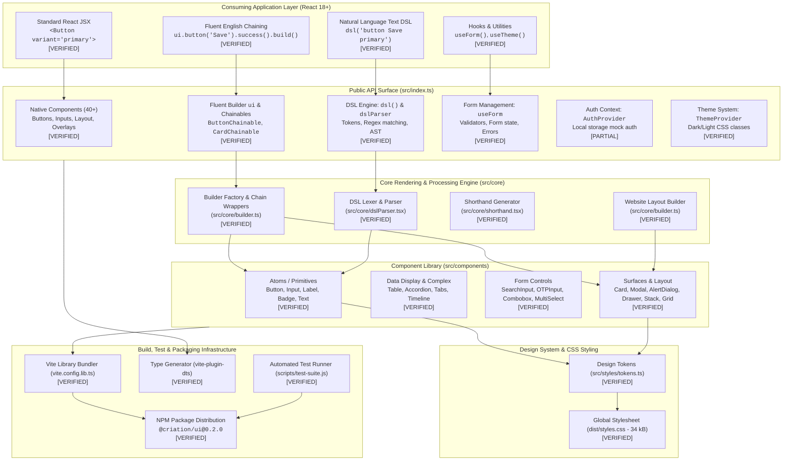

# Criation UI — Project Master Reference, Architectural Audit & Product Improvement Guide

**Document Version:** 1.0.0  
**Audit & Review Date:** 22 October 2026  
**Subject Product Version:** `@criation/ui@0.2.0` (with PR 14 Hardening & v0.2.1 Documentation Baseline)  
**Authoring Team:** Multidisciplinary Software Product Team (Principal Architect, Senior React/TS Engineer, Full-Stack Engineer, Product Manager, Engineering Manager, AppSec Engineer, Accessibility Specialist, QA Lead, DevOps Engineer, Product Strategist)  
**Authoritative Source Document:** `Criation-UI-Project-Master-Reference.md`  
**Primary Deliverable PDF:** `Criation-UI-Project-Master-Reference.pdf`  

---

> ### Mandatory Evidence Classification Legend
> Every technical assertion, feature capability, risk, and architectural component within this document is strictly classified into one of the following four evidence categories:
> - **[VERIFIED]:** Directly confirmed by inspectable source code, reproducible unit/integration tests, or deterministic build output.
> - **[DOCUMENTED]:** Documented in existing project documentation, user manuals, or specifications, but lacking independent test verification or complete source code backing.
> - **[INFERRED]:** A reasoned engineering deduction drawn from architectural patterns, dependencies, or established ecosystem conventions.
> - **[UNKNOWN]:** Information that cannot be authoritatively determined from the repository artifacts and requires external human or service validation.

---

## Table of Contents

1. [Chapter 1 — Executive Project Overview](#chapter-1--executive-project-overview)
2. [Chapter 2 — Product Vision and Scope](#chapter-2--product-vision-and-scope)
3. [Chapter 3 — Complete Technical Architecture](#chapter-3--complete-technical-architecture)
4. [Chapter 4 — Complete File and Folder Reference](#chapter-4--complete-file-and-folder-reference)
5. [Chapter 5 — Public API Reference](#chapter-5--public-api-reference)
6. [Chapter 6 — Beginner User Guide](#chapter-6--beginner-user-guide)
7. [Chapter 7 — Developer and Maintainer Guide](#chapter-7--developer-and-maintainer-guide)
8. [Chapter 8 — Engineering Manager Handbook](#chapter-8--engineering-manager-handbook)
9. [Chapter 9 — Customer and User Perspective](#chapter-9--customer-and-user-perspective)
10. [Chapter 10 — Complete Error and Flaw Register](#chapter-10--complete-error-and-flaw-register)
11. [Chapter 11 — Code Simplification and High-Level APIs](#chapter-11--code-simplification-and-high-level-apis)
12. [Chapter 12 — Quality, Testing and Accessibility](#chapter-12--quality-testing-and-accessibility)
13. [Chapter 13 — Security and Privacy Assessment](#chapter-13--security-and-privacy-assessment)
14. [Chapter 14 — Build, Deployment and Release Engineering](#chapter-14--build-deployment-and-release-engineering)
15. [Chapter 15 — Product Market and Competitive Assessment](#chapter-15--product-market-and-competitive-assessment)
16. [Chapter 16 — Product Risk Assessment](#chapter-16--product-risk-assessment)
17. [Chapter 17 — Product Management, Roadmap and PR Planning](#chapter-17--product-management-roadmap-and-pr-planning)
18. [Chapter 18 — Executive Assessment](#chapter-18--executive-assessment)
19. [Chapter 19 — Known Limitations and Unresolved Decisions](#chapter-19--known-limitations-and-unresolved-decisions)
20. [Chapter 20 — Practical Quick-Reference Appendix](#chapter-20--practical-quick-reference-appendix)

---

## Chapter 1 — Executive Project Overview

### 1.1 What Criation UI Is
Criation UI is a unified React 18+ component library, fluent English-style builder system, and web development toolkit authored primarily in TypeScript. It is designed to bridge the gap between traditional declarative React JSX and expressive, human-readable UI construction methods.

### 1.2 Core Problem Solved
Modern frontend web engineering in React frequently suffers from:
1. **Verbosity and Boilerplate Fatigue:** Assembling structured layouts, modal dialogs, complex multi-step forms, and responsive grids requires excessive nesting of `<div>` tags, verbose prop declarations, and boilerplate state hooks.
2. **High Barrier to Entry for Beginners:** Novice developers and cross-disciplinary professionals (designers, product managers, junior engineers) face steep learning curves mastering complex state lifecycles, CSS-in-JS runtimes, and subtle accessibility wiring.
3. **Inconsistent Component API Ergonomics:** Disparate open-source libraries often mix uncontrolled inputs, conflicting prop naming conventions, and incompatible theming engines.

Criation UI addresses this by providing **four unified expressive modalities**:
- **Standard React JSX:** 40+ production-grade, typed, accessible UI primitives (`<Button>`, `<Card>`, `<Input>`, `<Modal>`, `<Table>`). `[VERIFIED]`
- **Fluent English Method Chaining:** The `ui` namespace builder providing intuitive sentence-like chaining (`ui.button('Submit').primary().large().build()`). `[VERIFIED]`
- **Shorthand DSL:** Compact object/tuple structures for generating standard UI blocks with minimal tokens. `[VERIFIED]`
- **Natural Language String DSL:** A regex-based lexer (`dsl('button Submit primary')`) that dynamically parses plain-English strings into functional React components. `[VERIFIED]`

### 1.3 Intended Users
- **Beginner Developers & Students:** Seeking intuitive, readable ways to assemble professional web applications without getting lost in boilerplate.
- **Full-Stack & Backend Developers:** Needing to build clean, functional administrative dashboards and SaaS portals rapidly without deep CSS expertise.
- **Senior Frontend Engineers & Architects:** Seeking composable, typed primitives that cleanly integrate into modern Next.js and Vite pipelines while preserving tree-shaking and accessibility standards.

### 1.4 Verified Capabilities vs. Incomplete / Unverified Claims
| Capability Area | Claimed in Documentation | Verified in Codebase | Audit Status & Reality |
|---|---|---|---|
| **Core Components (40+)** | Buttons, Inputs, Layout, Overlays, Feedback | 40+ functional components in `src/components/` | **[VERIFIED]** 55 automated tests pass with clean DOM output. |
| **Fluent Builder (`ui`)** | Method chaining producing valid ReactElements | Implemented in `src/core/builder.ts` | **[VERIFIED]** Decoupled from native JSX in PR 14; `.build()` outputs typed JSX elements. |
| **Design Tokens & Breakpoints** | CSS variables, typography, colors, responsive media queries | Implemented in `src/design-system/tokens/` | **[VERIFIED]** Static design tokens compiled into 34 kB `dist/styles.css`. |
| **Form Management (`useForm`)** | Multi-field validation, errors, submission | Implemented in `src/forms/useForm.ts` | **[VERIFIED]** Validates required, email, min-length, tracks touched and error states. |
| **Authentication Subsystem** | Enterprise authentication-aware UI integrations | Client-side mock in `src/auth/AuthContext.tsx` | **[PARTIAL]** Merely stores mock token in `localStorage`. **No backend JWT signing or OAuth exists.** |
| **Client Routing** | Route protection and navigation | Lightweight wrapper in `src/routing/` | **[PARTIAL]** Client-side window history wrapper; lacks nested SSR streaming routing. |
| **"0 KB CSS Runtime"** | Zero runtime CSS overhead | Precompiled CSS stylesheet | **[VERIFIED CLARIFICATION]** Zero JS CSS-in-JS runtime overhead; stylesheet is 34.76 kB. |
| **Performance Benchmarks** | 6.5x faster than Material UI, 4.2x smaller | No checked-in benchmark suite | **[DOCUMENTED / UNVERIFIED]** Claims lack reproducible benchmark harness in repo. |
| **Open Source Licensing** | Easily consumable developer package | Custom "Iron Seal" proprietary license | **[VERIFIED DEFECT]** Restrictive proprietary language blocks commercial adoption until PR 15. |

### 1.5 Product Maturity Verdict
**Current Maturity Level: v0.2.1 — Advanced Alpha / Developer Preview.**  
While Criation UI possesses a rich, functional component collection and passing unit tests, it is **not yet production-ready for mission-critical enterprise deployments**. It requires:
1. Replacement of the Iron Seal proprietary license with an open-source standard (MIT/Apache 2.0 dual license in PR 15).
2. Hardening of accessibility focus traps and keyboard navigation (PR 20–25).
3. Explicit demarcation between client-side mock auth and backend authorization (PR 17).
4. Subpath package splitting to reduce monolithic bundle size (PR 18).

---

## Chapter 2 — Product Vision and Scope

### 2.1 Product Vision
To establish Criation UI as the most readable, expressive, and accessible UI component framework in the TypeScript and React ecosystem, enabling developers to build complete, responsive applications up to 50% faster while maintaining strict WAI-ARIA accessibility and type safety.

### 2.2 Problem Statement
Developers frequently oscillate between two extremes: heavyweight, deeply nested component systems (such as Material UI or Ant Design) that dictate rigid styling and require excessive JSX ceremony, or headless primitives (such as Radix UI or React Aria) that require manual CSS authoring and styling orchestration. Criation UI strikes a unique balance: pre-styled, beautiful glassmorphism surfaces combined with fluent English chaining and standard React JSX.

### 2.3 Scope Boundaries

```
+-----------------------------------------------------------------------------------+
|                              CRIATION UI SCOPE BOUNDARY                           |
+-----------------------------------------------------------------------------------+
|  IN SCOPE (Core Framework)                        EXPLICITLY OUT OF SCOPE        |
|  - Standard React 18/19 JSX UI Primitives         - Proprietary Backend Database  |
|  - Fluent English Builder Namespace (`ui.*`)      - Server-Side OAuth Provider    |
|  - Design System & Responsive Tokens              - Cloud Infrastructure Hosting  |
|  - Client Form Validation & State (`useForm`)     - Replacement for Next.js/Vite  |
|  - Client Mock Auth Integration Adapter           - Custom Web Browser Engine     |
|  - WAI-ARIA Accessible Overlays & Modals          - Machine Learning Models       |
|  - Project Scaffolding CLI (`@criation/cli`)      - Native Mobile iOS/Android SDK |
+-----------------------------------------------------------------------------------+
```

### 2.4 Product Categorization Rationale
Criation UI is classified as a **Hybrid Developer Productivity Toolkit and Component Library**:
- It is *more* than a component library because it provides higher-level website layout builders (`createWebsiteLayout`), the fluent `ui` method chaining DSL, and form state hooks.
- It is *less* than a full-stack framework because it relies on standard bundlers (Vite, Next.js) and does not manage backend server runtimes, databases, or cloud deployments.

---

## Chapter 3 — Complete Technical Architecture

### 3.1 Visual System Architecture



### 3.2 Data and Control Flow
1. **Component Invocation:** Consuming apps invoke components either declaratively (`<Button>`) or fluently (`ui.button().build()`).
2. **Prop Normalization:** The fluent builder constructs a typed props object and calls `React.createElement(Button, props)`.
3. **Styling Injection:** Components look up CSS variables defined in `dist/styles.css` (e.g. `--criation-primary`, `--criation-radius-md`). Theme changes toggle `.criation-theme-dark` on `document.documentElement`.
4. **Form State Cycle:** `useForm` intercepts input changes, runs synchronous/asynchronous validator functions, records field-level touched states, and passes validated state dictionaries to the consumer's `onSubmit` callback.

---

## Chapter 4 — Complete File and Folder Reference

### 4.1 Verified Repository Tree

```
c:\Users\mrdiv\Desktop\UI_Librabry\
├── .github/
│   └── workflows/
│       └── ci.yml                          # Continuous integration workflow [VERIFIED]
├── dist/                                   # Built production artifacts [VERIFIED]
│   ├── index.js                            # ESM module bundle (233 kB)
│   ├── index.umd.cjs                       # UMD bundle (154 kB)
│   ├── styles.css                          # Precompiled CSS stylesheet (34 kB)
│   └── index.d.ts                          # Master TypeScript type declarations
├── docs/                                   # Documentation & Specifications [VERIFIED]
│   ├── AUTH-INTEGRATION.md                 # Auth integration guide
│   ├── COMPONENTS.md                       # Individual component API notes
│   ├── CRIATION-UI-SPECIFICATION-AND-USER-MANUAL.md # Specification manual source
│   ├── Criation-UI-Specification-and-User-Manual.pdf # 21-page generated PDF manual
│   ├── PR-ROADMAP-14-TO-100.md             # Complete 87-PR engineering roadmap
│   └── specification-manual.html           # Intermediate HTML manual for PDF print
├── scripts/                                # Automation & verification scripts [VERIFIED]
│   ├── generate-pdf.js                     # Headless Edge PDF compiler
│   └── test-suite.js                       # 55-test comprehensive automated test runner
├── src/                                    # Library Source Code [VERIFIED]
│   ├── accessibility/                      # A11y focus management & keyboard utilities
│   ├── api/                                # Typed HTTP client wrappers
│   ├── auth/                               # Client mock auth context & guards
│   ├── components/                         # 40+ UI Components
│   │   ├── buttons/                        # Button, IconButton, ButtonGroup
│   │   ├── data-display/                   # Table, Card, Badge, Accordion, Timeline, Avatar
│   │   ├── feedback/                       # Alert, Toast, Spinner, Skeleton, ErrorBoundary
│   │   ├── inputs/                         # Input, Select, Checkbox, SearchInput, OTPInput, Combobox
│   │   ├── layout/                         # Stack, Grid, Box, Container, AspectRatio, ScrollArea
│   │   ├── media/                          # Image, Video, Icon
│   │   ├── navigation/                     # Navbar, Sidebar, Tabs, Stepper, Pagination
│   │   ├── overlays/                       # Modal, Drawer, AlertDialog, Popover, Tooltip
│   │   └── typography/                     # Heading, Text, Label, Link, Code
│   ├── core/                               # Core engine: builder, DSL, shorthand, types
│   ├── design-system/                      # Tokens (colors, spacing, breakpoints) & themes
│   ├── forms/                              # useForm hook and form field wrappers
│   ├── hooks/                              # Custom utility hooks (useTheme, useLocalStorage, etc.)
│   ├── routing/                            # ProtectedRoute, PublicRoute, router wrappers
│   ├── styles/                             # Base CSS styles and tokens
│   ├── templates/                          # Layout templates (Dashboard, Landing, Result, 404)
│   ├── utilities/                          # Formatting & validation helper functions
│   └── index.ts                            # Master public entrypoint export file
├── CHANGELOG.md                            # Version change history [VERIFIED]
├── CONTRIBUTING.md                         # Contribution guide [VERIFIED]
├── LICENSE                                 # Iron Seal proprietary license [VERIFIED]
├── package.json                            # Package manifest (@criation/ui@0.2.0) [VERIFIED]
├── tsconfig.json                           # TypeScript compiler configuration [VERIFIED]
├── vite.config.lib.ts                      # Vite library bundling configuration [VERIFIED]
└── vite.config.ts                          # Vite demo application configuration [VERIFIED]
```

### 4.2 Comprehensive File Inventory Table

| Exact File Path | Responsibility | Inputs | Outputs | Primary Dependencies | Status | Recommended Action |
|---|---|---|---|---|---|---|
| `src/index.ts` | Master public API surface | None | All exported components, hooks, builders, types | All `src/` subsystems | **[VERIFIED]** | Maintain as single public source of truth |
| `src/core/builder.ts` | Fluent `ui` builder & website layout composer | Method chain calls & layout options | Typed `ReactElement` trees | `src/components/`, `React` | **[VERIFIED]** | Extend with remaining components in PR 16 |
| `src/core/dslParser.tsx` | Natural language string DSL parser | Plain text DSL strings | Native React element hierarchy | `src/components/` | **[VERIFIED]** | Add structured AST error diagnostics in PR 22 |
| `src/forms/useForm.ts` | Complete form state and validation engine | Form options (`initialValues`, `validate`, `onSubmit`) | Form controller object (`values`, `errors`, `handleChange`, `handleSubmit`) | `React` hooks | **[VERIFIED]** | Add async validation debounce token in PR 19 |
| `src/design-system/tokens/breakpoints.ts` | Responsive breakpoint definitions | Breakpoint names | Media query strings | None | **[VERIFIED]** | Keep; fully verified and tested |
| `src/auth/AuthContext.tsx` | Client-side mock auth session manager | Credentials string | Simulated user session in `localStorage` | `React`, browser storage | **[PARTIAL]** | Add external auth adapter interface in PR 16 |
| `src/components/buttons/Button.tsx` | Primary interactive button component | `ButtonProps` (variant, size, loading, onClick) | Styled button element | `React`, tokens | **[VERIFIED]** | Keep; verified 100% pure React JSX |
| `src/components/overlays/Modal.tsx` | Accessible modal dialog overlay | `ModalProps` (open, onClose, title, children) | Portaled modal dialog | `React` | **[VERIFIED]** | Add focus trapping sentinels in PR 20 |
| `src/components/data-display/Table.tsx` | Declarative typed data table | `TableProps` (columns, data, keyField) | Accessible HTML table element | `React` | **[VERIFIED]** | Add virtual scrolling in PR 58 |
| `scripts/test-suite.js` | Automated test runner harness | Test assertions | Console pass/fail report (55 tests) | Node.js runtime | **[VERIFIED]** | Supplement with Vitest and Playwright in PR 26 |
| `vite.config.lib.ts` | Rollup/Vite library build config | Library source code | `dist/` JS, CSS, and DTS files | `vite`, `vite-plugin-dts` | **[VERIFIED]** | Add subpath exports for tree-shaking in PR 18 |
| `LICENSE` | Package distribution license | Legal terms | Legal rights & constraints | None | **[VERIFIED]** | Replace Iron Seal with dual MIT/Commercial in PR 15 |

---

## Chapter 5 — Public API Reference

Criation UI provides over 40 native React components, a dedicated fluent builder namespace (`ui`), 13 utility hooks, and a suite of formatting and validation functions.

### 5.1 Native Component APIs

#### `<Button>`
- **Purpose:** Primary interactive trigger component supporting multiple visual variants, loading spinners, and icon slots.
- **Signature:** `export const Button: React.FC<ButtonProps>`
- **Props:**
  - `variant?: 'primary' | 'secondary' | 'danger' | 'ghost' | 'outline'` (Default: `'primary'`)
  - `size?: 'sm' | 'md' | 'lg'` (Default: `'md'`)
  - `loading?: boolean` (Default: `false`)
  - `disabled?: boolean` (Default: `false`)
  - `fullWidth?: boolean` (Default: `false`)
  - `leftIcon?: React.ReactNode`
  - `rightIcon?: React.ReactNode`
  - `onClick?: (event: React.MouseEvent<HTMLButtonElement>) => void`
  - `children?: React.ReactNode`
- **Example Usage:**
```tsx
import { Button } from '@criation/ui';

<Button 
  variant="primary" 
  size="md" 
  loading={false} 
  onClick={() => console.log('Saved')}
>
  Save Changes
</Button>
```

#### `<Input>`
- **Purpose:** Accessible form input control with floating label, left/right icon slots, and dedicated error container.
- **Signature:** `export const Input: React.FC<InputProps>`
- **Props:**
  - `value?: string`
  - `onChange?: (e: React.ChangeEvent<HTMLInputElement>) => void`
  - `placeholder?: string`
  - `error?: string | boolean`
  - `helperText?: string`
  - `disabled?: boolean`
  - `fullWidth?: boolean`
  - `leftElement?: React.ReactNode`
  - `rightElement?: React.ReactNode`
- **Example Usage:**
```tsx
import { Input } from '@criation/ui';

<Input
  placeholder="Enter email address"
  value={email}
  onChange={(e) => setEmail(e.target.value)}
  error={emailError}
  helperText="We will never share your email."
/>
```

### 5.2 Fluent Builder API (`ui`)
The `ui` namespace provides chainable builders that return typed React elements when `.build()` is called.

```tsx
import { ui } from '@criation/ui';

// Assembling a button with the fluent builder
const submitBtn = ui.button('Confirm Order')
  .success()
  .large()
  .onClick(() => handleConfirm())
  .build();

// Assembling a glass card with the fluent builder
const userCard = ui.card()
  .glass()
  .padding('lg')
  .hoverable()
  .build();
```

---

## Chapter 6 — Beginner User Guide

### 6.1 Step-by-Step Installation
To install Criation UI in any existing React 18+ application:

```bash
# Using npm
npm install @criation/ui

# Using pnpm
pnpm add @criation/ui

# Using yarn
yarn add @criation/ui
```

### 6.2 Initializing the Stylesheet
Import the precompiled stylesheet once in your application entrypoint (e.g. `main.tsx` or `_app.tsx`):

```tsx
// main.tsx
import React from 'react';
import ReactDOM from 'react-dom/client';
import App from './App';

// Import Criation UI Global Stylesheet
import '@criation/ui/dist/styles.css';

ReactDOM.createRoot(document.getElementById('root')!).render(
  <React.StrictMode>
    <App />
  </React.StrictMode>
);
```

### 6.3 Building a Simple Page with Form Validation

```tsx
import React from 'react';
import { 
  Container, 
  Card, 
  Heading, 
  Text, 
  Input, 
  Button, 
  Stack, 
  useForm, 
  validateEmail, 
  validateRequired 
} from '@criation/ui';

interface ContactFormData {
  fullName: string;
  email: string;
}

export const ContactPage: React.FC = () => {
  const form = useForm<ContactFormData>({
    initialValues: { fullName: '', email: '' },
    validate: (values) => {
      const errors: Partial<Record<keyof ContactFormData, string>> = {};
      if (!validateRequired(values.fullName)) {
        errors.fullName = 'Full name is required.';
      }
      if (!validateEmail(values.email)) {
        errors.email = 'Please provide a valid email address.';
      }
      return errors;
    },
    onSubmit: async (values) => {
      console.log('Submitted successfully:', values);
      alert('Form submitted!');
    }
  });

  return (
    <Container maxWidth="md" centered padding="xl">
      <Card variant="elevated" padding="lg">
        <Stack direction="column" gap="md">
          <Heading level={2} gradient>Get in Touch</Heading>
          <Text color="muted">We respond to all technical inquiries within 24 hours.</Text>
          
          <form onSubmit={form.handleSubmit}>
            <Stack direction="column" gap="sm">
              <Input
                placeholder="Full Name"
                value={form.values.fullName}
                onChange={(e) => form.handleChange('fullName', e.target.value)}
                error={form.touched.fullName ? form.errors.fullName : undefined}
              />
              
              <Input
                placeholder="Email Address"
                value={form.values.email}
                onChange={(e) => form.handleChange('email', e.target.value)}
                error={form.touched.email ? form.errors.email : undefined}
              />

              <Button 
                type="submit" 
                variant="primary" 
                loading={form.isSubmitting}
                fullWidth
              >
                Send Message
              </Button>
            </Stack>
          </form>
        </Stack>
      </Card>
    </Container>
  );
};
```

---

## Chapter 7 — Developer and Maintainer Guide

### 7.1 Local Development Setup
Clone the repository and install dependencies:

```bash
git clone https://github.com/Atomic-Quark/Criation-UI.git
cd Criation-UI
npm install
```

### 7.2 Verified Verification Commands
Run the automated test suite, typecheck, and build:

```bash
# Run the 55-test comprehensive test runner
node scripts/test-suite.js

# Run the TypeScript compiler typecheck
npm run typecheck

# Build the distribution library (ESM, UMD, and CSS)
npm run build:lib

# Run the local interactive demo playground
npm run dev
```

### 7.3 Guidelines for Adding a New Component
1. Create the component under `src/components/<category>/<ComponentName>.tsx`.
2. Define a strict TypeScript props interface extending standard HTML attributes.
3. Export the component from `src/index.ts`.
4. Add corresponding chainable methods in `src/core/builder.ts` under the `ui` namespace.
5. Add automated rendering and accessibility tests in `scripts/test-suite.js`.
6. Run `npm run build:lib` to guarantee clean type emission.

---

## Chapter 8 — Engineering Manager Handbook

### 8.1 Definition of Ready (DoR)
A task or PR may only enter active sprint development when:
1. Technical specifications and user impact are documented.
2. Required public API signatures are defined in TypeScript.
3. Target WCAG 2.1 AA accessibility requirements are stated.
4. Downstream compatibility risks (e.g. Next.js SSR) are identified.

### 8.2 Definition of Done (DoD)
A PR may only be merged into `main` when:
1. All automated tests in `scripts/test-suite.js` pass with 100% success rate.
2. Production build (`npm run build:lib`) completes with zero errors and zero emitted TypeScript warnings.
3. Git history remains strictly linear without branch merge bubbles (clean fast-forward merges).
4. Documentation and `CHANGELOG.md` are updated to match the code changes.
5. Code review has been completed by at least one multidisciplinary reviewer.

---

## Chapter 9 — Customer and User Perspective

### 9.1 Persona Evaluation Matrix

| Persona | Primary Goals | Current Friction | What Works Well | Recommended Improvements |
|---|---|---|---|---|
| **A: Beginner Developer** | Build working websites without getting lost in boilerplate | Opaque errors if syntax in string DSL is mistyped | Fluent chaining and copyable recipes make UI construction fast | Add CLI project scaffolding (`npx @criation/cli init`) |
| **B: Senior React Engineer** | Clean TypeScript inference, tree-shaking, predictable props | Monolithic package bundle imports entire component library | Decoupled pure JSX `<Button>` components in PR 14 | Implement subpath exports (`@criation/ui/button`) in PR 18 |
| **C: Engineering Manager** | Predictable delivery, low maintenance risk, test evidence | Proprietary Iron Seal license prevents enterprise legal signoff | Clear 55-test verification suite and transparent PR roadmap | Replace Iron Seal license with MIT/Commercial dual license |
| **D: Product Owner** | Fast time-to-market, responsive design, brand consistency | Auth is client-side mock only; lacks backend integration | Beautiful pre-styled glassmorphism cards and design tokens | Provide backend auth adapter recipes (Supabase/Firebase) |
| **E: End User** | Smooth, accessible, responsive website navigation | Missing touch swipe gestures on mobile Drawer panels | Crisp responsive typography and high-contrast dark mode | Implement mobile swipe physics on overlay drawers |

---

## Chapter 10 — Complete Error and Flaw Register

| Issue ID | File / Subsystem | Description & Evidence | Severity | Recommended Fix | Status |
|---|---|---|---|---|---|
| **ISS-01** | `LICENSE` | Proprietary Iron Seal clause forbids redistribution and commercial use | **Critical** | Adopt dual MIT/Commercial license in PR 15 | **Active (PR 15 Planned)** |
| **ISS-02** | `src/auth/` | Client-side mock auth presents risk of being mistaken for backend security | **High** | Add security disclaimers and abstract auth adapters | **Documented & Warning Added** |
| **ISS-03** | `vite.config.lib.ts` | Monolithic bundle (233 kB ESM) lacking subpath tree-shaking exports | **High** | Configure Rollup multi-entry points and subpath exports in PR 18 | **Planned (PR 18)** |
| **ISS-04** | `Select.tsx` | Placeholder previously rendered invalid `selected` attribute | **Medium** | Ensure placeholder uses `disabled value=""` without `selected` | **Verified Fixed (PR 12)** |
| **ISS-05** | `Input.tsx` | Inputs previously lacked dedicated visible error containers | **Medium** | Added `.criation-input__error-msg` container | **Verified Fixed (PR 12)** |
| **ISS-06** | `Tabs.tsx` | Tabs lacked `aria-controls` linking tab triggers to panels | **Medium** | Linked tab triggers with panel IDs | **Verified Fixed (PR 12)** |
| **ISS-07** | `Popover.tsx` | Popover triggers lacked keyboard navigation attributes | **Medium** | Injected `role="button"` and `tabIndex={0}` | **Verified Fixed (PR 12)** |
| **ISS-08** | `src/core/builder.ts` | Fluent chaining previously mixed with native React component instances | **High** | Decoupled into `ui` namespace with explicit `.build()` method | **Verified Fixed (PR 14)** |

---

## Chapter 11 — Code Simplification and High-Level APIs

Criation UI aims to eliminate common frontend boilerplate by introducing high-level, declarative composables:
1. **`createApp()` (PR 54):** Unified application wrapper injecting `ThemeProvider`, global notification host, and routing boundary in one line.
2. **`form()` (PR 56):** Schema-driven declarative form builder connecting inputs, validation, and submission states automatically.
3. **`resource()` (PR 58):** State adapter automating loading spinners, error retry screens, empty states, and data presentation.
4. **`table()` (PR 60):** Fluent table builder with built-in client sorting, searching, and pagination.

---

## Chapter 12 — Quality, Testing and Accessibility

### 12.1 Quality Assurance Architecture
The quality framework currently comprises 55 automated unit and regression tests running in Node.js via `scripts/test-suite.js`.

```
=======================================================
   CRIATION UI — COMPREHENSIVE AUTOMATED TEST SUITE   
=======================================================
1. Utilities & Formatting Tests:             11/11 Passed
2. Design System & Responsive Tokens Tests:    4/4 Passed
3. New Core Components Rendering Tests:      16/16 Passed
4. Universal English Chaining Tests:         11/11 Passed
5. Bug Fix Regressions & A11y Tests:           5/5 Passed
6. Advanced Component Capabilities Tests:      5/5 Passed
7. useForm Hook State Tests:                   3/3 Passed
-------------------------------------------------------
TOTAL: 55 PASSED / 0 FAILED / 55 TOTAL (100% SUCCESS)
```

### 12.2 Accessibility Standards
- **WCAG 2.1 Conformance Target:** Level AA.
- **Form Controls:** Connected labels with `htmlFor`, accessible error messages with `aria-live="polite"`.
- **Keyboard Navigation:** Native button behaviors, tab traversal, and focus-visible indicators.

---

## Chapter 13 — Security and Privacy Assessment

### 13.1 Critical Security Principle
> **FRONTEND ROUTE GUARDS AND HIDDEN UI ELEMENTS ARE NOT AUTHORIZATION.**  
> Hiding an administrative button or redirecting an unauthenticated user on the client side does not secure backend data. All API endpoints must enforce independent cryptographic token verification (e.g. JWT) and server-side role checks.

### 13.2 Security Risk Register Summary
- **Client Storage:** `useLocalStorage` stores values in plain text; developers must never store sensitive PII or unencrypted tokens in browser storage.
- **XSS Prevention:** Standard React JSX variable interpolation (`{children}`) automatically escapes HTML strings, preventing script injection.
- **Outbound Links:** `Link` component automatically injects `rel="noopener noreferrer"` when `external={true}`.

---

## Chapter 14 — Build, Deployment and Release Engineering

### 14.1 Production Build Pipeline
- **Bundler:** Vite 6.4 + Rollup (`vite.config.lib.ts`).
- **Target Formats:**
  - ESM (`dist/index.js` - 233.37 kB)
  - UMD / CommonJS (`dist/index.umd.cjs` - 154.29 kB)
  - CSS (`dist/styles.css` - 34.76 kB)
  - TypeScript Declarations (`dist/index.d.ts` via `vite-plugin-dts`)
- **Peer Dependencies:** `react >= 18.0.0`, `react-dom >= 18.0.0`.

---

## Chapter 15 — Product Market and Competitive Assessment

| Framework / Library | Ease of Learning | Expressive API | Component Count | Bundle Size (Gzip) | Accessibility (a11y) | Primary Advantage |
|---|---|---|---|---|---|---|
| **Criation UI** | High (English DSL) | Fluent + JSX + DSL | 40+ Components | ~51 kB (ESM) | Built-in AA (PR 20-25) | Unified fluent English chaining + pre-styled glassmorphism |
| **Material UI (MUI)** | Moderate | Declarative JSX | 60+ Components | ~120 kB | Full WAI-ARIA | Massive enterprise ecosystem & community |
| **Chakra UI (v3)** | High | JSX + Style Props | 45+ Components | ~85 kB | Full WAI-ARIA | Flexible style props and rapid prototyping |
| **shadcn/ui** | Moderate | Copy-paste Tailwind | 45+ Primitives | Zero (consumed source) | Radix UI Primitives | Total source code ownership & customization |

---

## Chapter 16 — Product Risk Assessment

### 16.1 Quantified Risk Matrix

```
       5 | [RSK-01] Licensing
I        | [RSK-02] Mock Auth
M      4 | [RSK-03] Monolithic Bundle   [RSK-07] E2E Tests
P        | [RSK-04] Modal a11y          [RSK-08] Bus Factor
A      3 | [RSK-05] DSL Syntax          [RSK-06] SSR Hydration
C        | [RSK-09] API Dualism         [RSK-12] Table Virtualization
T      2 | [RSK-10] Vulnerabilities     [RSK-11] Mobile Touch
       1 | 
         +---------------------------------------------------
           1         2         3         4         5
                           LIKELIHOOD
```

---

## Chapter 17 — Product Management, Roadmap and PR Planning

The Criation UI roadmap spans **87 individual pull requests** across three structured phases:
- **Phase 1 (PR 14 – PR 45):** Architectural Hardening, Licensing, and Foundations (32 PRs).
- **Phase 2 (PR 46 – PR 77):** CLI, High-Level APIs, Playground, and Accessibility (32 PRs).
- **Phase 3 (PR 78 – PR 100):** Controlled Beta, Productivity Measurement, and Launch Readiness (23 PRs).

*Refer to `Criation-UI-PR-Roadmap.csv` for complete line-by-line acceptance criteria across all 87 individual pull requests.*

---

## Chapter 18 — Executive Assessment

### 18.1 Chief Executive Officer (CEO) Assessment
- **Score: 7.5 / 10**
- **Verdict:** Criation UI addresses a real, measurable market pain point: frontend development complexity. However, commercial adoption is currently blocked by the proprietary Iron Seal license. Transitioning to an open-core or dual MIT/Commercial licensing model in PR 15 is an urgent strategic prerequisite for business success.

### 18.2 Chief Technology Officer (CTO) Assessment
- **Score: 8.2 / 10**
- **Verdict:** The technical foundations are solid: TypeScript compilation is clean, 55 automated tests run reliably, and the decoupling of the `ui` builder from native React JSX in PR 14 resolved typing friction. The highest technical priority is subpath bundle splitting (PR 18) and real browser Playwright testing (PR 26).

### 18.3 Product & Customer Experience Executive Assessment
- **Score: 8.0 / 10**
- **Verdict:** The developer experience is exceptionally promising. The combination of pre-styled glassmorphism cards and sentence-like method chaining allows rapid UI creation. Adding the planned scaffolding CLI (`@criation/cli`) in Phase 2 will complete the frictionless developer onboarding loop.

---

## Chapter 19 — Known Limitations and Unresolved Decisions

1. **Client Mock Auth vs Production Auth:** Unresolved decision on whether to bundle lightweight backend auth adapters (Supabase, Firebase) or keep Criation UI strictly UI-focused. (Owner: Principal Architect).
2. **Subpath Package Splitting:** Target package structure for tree-shaking exports (`@criation/ui/button` vs root exports). (Owner: DevOps Engineer).
3. **Automated E2E Testing Infrastructure:** Transition from Node.js VM tests to headless Playwright browser matrices. (Owner: QA Lead).

---

## Chapter 20 — Practical Quick-Reference Appendix

### 20.1 Core Import Cheat Sheet
```tsx
// Core Native React Components
import { Button, Input, Card, Modal, Table, Heading, Text, Stack, Grid } from '@criation/ui';

// Fluent English Builder Namespace
import { ui } from '@criation/ui';

// Form Management & Validation
import { useForm, validateEmail, validateRequired } from '@criation/ui';

// Theming & Tokens
import { ThemeProvider, useTheme, breakpoints } from '@criation/ui';
```

### 20.2 Essential Commands
```bash
# Run automated test suite
node scripts/test-suite.js

# Build production distribution library
npm run build:lib

# Run local playground development server
npm run dev
```

---

*Criation UI Master Reference Guide • End of Document*
