# Criation UI

<p align="center">
  
</p>

<p align="center">
  <a href="https://www.npmjs.com/package/@criation/ui"></a>
  <a href="LICENSE"></a>
  <a href="#test-verification"></a>
  <a href="#bundle-performance"></a>
  <a href="#accessibility-compliance"></a>
  <a href="#typescript-support"></a>
</p>

---

## Overview

**Criation UI** is a modular, high-performance React 18+ component library and developer toolkit designed for building production web applications. It provides standard React JSX components, an optional decoupled fluent builder, full-stack reactive data workflows (`useDataQuery`, `useCrudWorkflow`), and an integrated scaffolding CLI (`criation`).

All components are written in strict TypeScript, comply with WAI-ARIA 1.2 accessibility patterns, ship with precompiled CSS (~34.76 kB total, 6.8 kB gzipped) with zero JavaScript runtime overhead, and support multi-entry tree-shaking down to 2.54 kB per component.

---

## Table of Contents

- [Quick Start & Setup](#quick-start--setup)
  - [Prerequisites](#prerequisites)
  - [Option A: Scaffold a New Project with CLI](#option-a-scaffold-a-new-project-with-cli)
  - [Option B: Add to an Existing Project](#option-b-add-to-an-existing-project)
  - [Option C: Local Development & Contributing](#option-c-local-development--contributing)
- [How to Work with the Library](#how-to-work-with-the-library)
  - [1. Canonical JSX (Primary API)](#1-canonical-jsx-primary-api)
  - [2. Tree-Shaken Subpath Imports](#2-tree-shaken-subpath-imports)
  - [3. Decoupled Fluent Builder](#3-decoupled-fluent-builder)
  - [4. High-Level Reactive Workflows](#4-high-level-reactive-workflows)
  - [5. CLI Scaffolding Recipes](#5-cli-scaffolding-recipes)
- [Component & API Evolution](#component--api-evolution)
  - [Inventory of Updated Functions & Components](#inventory-of-updated-functions--components)
- [Code Comparison: What We Wrote Earlier vs. How We Write Now](#code-comparison-what-we-wrote-earlier-vs-how-we-write-now)
  - [1. Button Construction & Styling](#1-button-construction--styling)
  - [2. Form Inputs & Error Association](#2-form-inputs--error-association)
  - [3. Modal Dialogs & Keyboard Focus Trapping](#3-modal-dialogs--keyboard-focus-trapping)
  - [4. Data Management & CRUD Tables](#4-data-management--crud-tables)
  - [5. Package Imports & Tree-Shaking](#5-package-imports--tree-shaking)
- [Architecture & Bundle Benchmarks](#architecture--bundle-benchmarks)
- [Security & Authentication Advisory](#security--authentication-advisory)
- [Framework Support Matrix](#framework-support-matrix)
- [Test Verification & Quality Metrics](#test-verification--quality-metrics)
- [License](#license)

---

## Quick Start & Setup

### Prerequisites

- **Node.js**: Version 18.0.0 or higher (LTS recommended)
- **Package Manager**: npm 9+, pnpm 8+, or yarn 1.22+
- **React**: React 18.x or React 19.x

---

### Option A: Scaffold a New Project with CLI

The fastest way to start a new project with Criation UI pre-configured (React, TypeScript, Vite, and Criation UI styles) is using the built-in scaffolding tool:

```bash
# Initialize a new application in a dedicated directory
npx @criation/ui init my-dashboard

# Navigate into the project
cd my-dashboard

# Install dependencies and start the development server
npm install
npm run dev
```

---

### Option B: Add to an Existing Project

#### 1. Install the package

```bash
# Using npm
npm install @criation/ui

# Using pnpm
pnpm add @criation/ui

# Using yarn
yarn add @criation/ui
```

#### 2. Import global styles

Import the compiled stylesheet once at your application's root entry file (e.g., `src/main.tsx` or `src/index.tsx` in Vite, or `src/pages/_app.tsx` / `src/app/layout.tsx` in Next.js):

```tsx
// src/main.tsx
import React from "react";
import ReactDOM from "react-dom/client";
import App from "./App";

// Import Criation UI stylesheet
import "@criation/ui/styles.css";

ReactDOM.createRoot(document.getElementById("root")!).render(
  <React.StrictMode>
    <App />
  </React.StrictMode>
);
```

#### 3. Use components in your application

```tsx
// src/App.tsx
import { Button, Card, Stack, Heading, Text } from "@criation/ui";

export default function App() {
  return (
    <Card variant="outline" padding="lg">
      <Stack direction="column" gap="1rem">
        <Heading level={2}>Welcome to Criation UI</Heading>
        <Text color="muted">
          Your production component library is installed and operational.
        </Text>
        <Button variant="primary" size="md" onClick={() => alert("Action triggered")}>
          Get Started
        </Button>
      </Stack>
    </Card>
  );
}
```

---

### Option C: Local Development & Contributing

To run the Criation UI source repository locally, test changes, and use the interactive component studio:

```bash
# 1. Clone the repository
git clone https://github.com/Atomic-Quark/Criation-UI.git
cd Criation-UI

# 2. Install workspace dependencies
npm install

# 3. Launch the interactive development playground
npm run dev

# 4. Open http://localhost:5173 in your browser
```

Key local scripts:
- `npm run dev` &mdash; Starts the interactive component showcase and playground studio.
- `npm test` &mdash; Executes the 142 automated verification tests across unit, browser, and package layers.
- `npm run benchmark` &mdash; Runs micro-benchmarks and bundle-size audits.
- `npm run build:lib` &mdash; Compiles the production distribution bundle (`dist/`) with TypeScript declarations.
- `npm run audit` &mdash; Runs the automated quality and security checks.

---

## How to Work with the Library

### 1. Canonical JSX (Primary API)

The recommended way to use Criation UI is through standard React JSX. Every component accepts strongly-typed props with full IDE autocomplete:

```tsx
import { Button, Input, Modal, Stack } from "@criation/ui";
import { useState } from "react";

export function UserRegistration() {
  const [isOpen, setIsOpen] = useState(false);

  return (
    <Stack direction="column" gap="1rem">
      <Input placeholder="Enter email address" fullWidth />
      <Button variant="primary" onClick={() => setIsOpen(true)}>
        Open Confirmation
      </Button>

      <Modal
        isOpen={isOpen}
        onClose={() => setIsOpen(false)}
        title="Confirm Registration"
        footer={
          <Button variant="primary" onClick={() => setIsOpen(false)}>
            Accept & Continue
          </Button>
        }
      >
        Please review and accept our terms of service before proceeding.
      </Modal>
    </Stack>
  );
}
```

---

### 2. Tree-Shaken Subpath Imports

For applications where bundle size is critical, Criation UI supports subpath exports. This ensures that bundlers import only the exact component needed without bundling the rest of the library:

```tsx
// Imports only the Button chunk (2.54 kB)
import { Button } from "@criation/ui/button";

// Imports only the Input chunk (2.54 kB)
import { Input } from "@criation/ui/input";

// Imports only the layout and workflow hooks
import { useDataQuery, useCrudWorkflow } from "@criation/ui/workflows";
```

---

### 3. Decoupled Fluent Builder

For developers who prefer a fluent dot-chaining syntax, Criation UI provides an optional `ui.*` builder namespace. Unlike early prototypes, this builder is completely decoupled from React component prototypes and terminates in `.build()` to produce an immutable React element:

```tsx
import { ui } from "@criation/ui";

// Dot-chaining builder returning a standard React element
const ActionButton = ui.button("Save Changes")
  .primary()
  .large()
  .onClick(() => console.log("Saved"))
  .build();

const PageHeader = ui.heading("System Configuration")
  .level(1)
  .gradient()
  .center()
  .build();
```

---

### 4. High-Level Reactive Workflows

Rather than writing repetitive state management boilerplate for asynchronous data operations, Criation UI includes dedicated workflow hooks:

#### Data Fetching with `useDataQuery`
Provides built-in loading states, error handling, automatic retry delays, and AbortController request cancellation:

```tsx
import { useDataQuery, Spinner, Alert } from "@criation/ui";

function CustomerList() {
  const { data, loading, error, refetch } = useDataQuery(
    async () => {
      const response = await fetch("/api/customers");
      if (!response.ok) throw new Error("Failed to load customer records");
      return response.json();
    },
    { retries: 2, retryDelayMs: 500 }
  );

  if (loading) return <Spinner size="lg" />;
  if (error) return <Alert variant="danger" title="Network Error">{error.message}</Alert>;

  return (
    <ul>
      {data?.map(c => <li key={c.id}>{c.name} ({c.email})</li>)}
    </ul>
  );
}
```

#### Synchronized CRUD with `useCrudWorkflow`
Manages item lists, search filters, create/edit modals, and deletion workflows in 5 lines of declarative code:

```tsx
import { useCrudWorkflow, Button, Modal, Input } from "@criation/ui";

export function InventoryManager() {
  const {
    items,
    isCreateOpen,
    openCreate,
    closeCreate,
    createItem,
    deleteItem,
  } = useCrudWorkflow({
    initialItems: [
      { id: "1", title: "Standard Server Rack", quantity: 12 },
      { id: "2", title: "Gigabit Switch 48-Port", quantity: 5 }
    ]
  });

  return (
    <div>
      <Button variant="primary" onClick={openCreate}>Add Inventory Item</Button>

      <table>
        <tbody>
          {items.map(item => (
            <tr key={item.id}>
              <td>{item.title}</td>
              <td>Qty: {item.quantity}</td>
              <td>
                <Button variant="danger" size="sm" onClick={() => deleteItem(item.id)}>
                  Delete
                </Button>
              </td>
            </tr>
          ))}
        </tbody>
      </table>
    </div>
  );
}
```

---

### 5. CLI Scaffolding Recipes

The integrated CLI allows teams to scaffold templates and recipes directly into an active project:

```bash
# Add a complete, synchronized CRUD data table recipe
npx @criation/ui add crud

# Add an analytics dashboard template
npx @criation/ui add dashboard

# Run performance micro-benchmarks
npm run benchmark

# Run the complete test and type-checking audit
npm run cli -- audit
```

---

## Component & API Evolution

### Inventory of Updated Functions & Components

The library was overhauled to eliminate prototype mutation, unverified claims, and accessibility issues. Below is a summary of the key components and functions updated:

| Component / Function | What Was Changed | Impact & Benefit |
| :--- | :--- | :--- |
| **`Button`, `IconButton`, `ButtonGroup`** | Decoupled from React prototype mutation. Added structured props (`variant`, `size`, `loading`, `disabled`), `aria-busy`, and subpath exports. | Prevents React prototype pollution. Enables tree-shaking down to 2.54 kB. Screen readers properly announce loading states. |
| **`Input`, `TextArea`, `SearchInput`** | Connected error strings to input fields using `aria-describedby` and `aria-invalid`. Fixed placeholder contrast. | Screen readers now announce validation errors automatically upon focus. |
| **`Select`** | Removed invalid HTML `selected` attribute rendered on placeholder options. | Resolves React runtime console warnings and ensures cross-browser HTML compliance. |
| **`Modal`, `Drawer`, `AlertDialog`** | Integrated `useFocusTrap` (traps `Tab`/`Shift+Tab` within the dialog), automatic body scroll locking with scrollbar width compensation, and Escape key dismissal. | Full WCAG 2.2 AA compliance. Prevents keyboard users from tabbing to underlying background content. |
| **`Tabs`** | Connected tab triggers to tab panels via `aria-controls`, `aria-selected`, and `role="tab"`. Added arrow key navigation. | Complies with WAI-ARIA 1.2 Tabs design pattern. Screen readers correctly describe panel relationships. |
| **`Table` (Data Grid)** | Implemented declarative column definitions, custom cell renderers, empty state handling, and sortable headers. | Eliminates manual `<table>` HTML structure boilerplate. |
| **`useForm`** | Added synchronous/asynchronous validation schema support, touched/dirty field tracking, and automatic error mapping. | Provides form validation without requiring heavy external dependencies like Formik or React Hook Form. |
| **`useDataQuery`** | Built-in timeout handling, exponential retry backoff, and AbortController request cancellation on unmount. | Eliminates race conditions and memory leaks when components unmount during active fetch requests. |
| **`useCrudWorkflow`** | Unified state machine managing filtered records, search queries, active modal selection, and delete confirmation toasts. | Reduces data-table screen implementations from ~200 lines of boilerplate down to 5-10 declarative lines. |
| **`ui.*` Builder Namespace** | Rewritten as an immutable builder pattern ending in `.build()`. Added typed options objects (e.g., `ui.navbar({ brand, links })`). | Replaces ambiguous 8-slot positional string parameters with structured, typed methods and options objects. |
| **`describe()` / `parseDSL()`** | Bounded natural-language parser. Removed unsafe automatic permission inferencing from arbitrary keywords like "admin". Added syntax warnings. | Eliminates security confusion; developers explicitly control authorization logic. |
| **CLI (`bin/criation.js`)** | Standalone executable supporting `init`, `add crud`, `add dashboard`, `benchmark`, and `audit`. | Enables one-command project creation and recipe generation without manual configuration. |

---

## Code Comparison: What We Wrote Earlier vs. How We Write Now

### 1. Button Construction & Styling

#### Earlier (v0.1.0 / v0.2.0 Prototype)
Required memorizing rigid 8-slot positional parameters where unused slots had to be filled with empty strings, or relied on mutating React component prototypes:

```tsx
// EARLIER: Rigid 8-slot positional strings or prototype pollution
// Slot 1: label, Slot 2: width, Slot 3: id, Slot 4: auth, Slot 5: link, Slot 6: color
const OldButton = Button("Save Changes", "", "", "", "/settings", "red");

// OR prototype mutation (violated React rules):
Button.prototype.red = function() { /* mutated global React component */ };
```

#### Now (v0.3.0-beta Standard JSX & Decoupled Builder)
Standard, predictable React JSX with typed props, or an immutable dot-chaining builder:

```tsx
// NOW: Standard React JSX (Primary API)
import { Button } from "@criation/ui";

export function SaveButton() {
  return (
    <Button
      variant="danger"
      size="lg"
      loading={false}
      onClick={() => navigate("/settings")}
    >
      Save Changes
    </Button>
  );
}

// OR: Decoupled Fluent Builder (Optional)
import { ui } from "@criation/ui";

const SaveButtonElement = ui.button("Save Changes")
  .danger()
  .large()
  .link("/settings")
  .build();
```

---

### 2. Form Inputs & Error Association

#### Earlier (v0.1.0 / v0.2.0 Prototype)
Errors were rendered as independent unassociated HTML elements. Screen readers had no way to know an input had failed validation:

```tsx
// EARLIER: Unconnected error text; screen readers failed to announce validation errors
<div>
  <input type="text" placeholder="Enter email" />
  {hasError && <span className="error-text">Email address is invalid</span>}
</div>
```

#### Now (v0.3.0-beta Accessible Inputs & `useForm`)
Inputs automatically associate errors using `aria-describedby` and `aria-invalid`, ensuring full accessibility:

```tsx
// NOW: Fully accessible input linked to error container
import { Input, useForm } from "@criation/ui";

export function EmailField() {
  const { values, errors, handleChange, handleBlur } = useForm({
    initialValues: { email: "" },
    validate: (vals) => (!vals.email.includes("@") ? { email: "Valid email required" } : {})
  });

  return (
    <Input
      name="email"
      placeholder="Enter email"
      value={values.email}
      error={errors.email} /* Generates aria-invalid and aria-describedby automatically */
      onChange={handleChange}
      onBlur={handleBlur}
      fullWidth
    />
  );
}
```

---

### 3. Modal Dialogs & Keyboard Focus Trapping

#### Earlier (v0.1.0 / v0.2.0 Prototype)
Modals were simple `<div>` overlays without keyboard trap handling. Pressing `Tab` allowed users to navigate out of the modal and interact with buttons behind the overlay:

```tsx
// EARLIER: Naive overlay without focus containment or scroll locking
function OldModal({ isOpen, children }) {
  if (!isOpen) return null;
  return (
    <div className="backdrop">
      <div className="modal-box">{children}</div>
    </div>
  );
}
```

#### Now (v0.3.0-beta Accessible Modal)
Includes automated focus trapping, body scroll locking with scrollbar width compensation, and Escape key handling:

```tsx
// NOW: WAI-ARIA 1.2 compliant modal with focus containment and scroll compensation
import { Modal, Button } from "@criation/ui";

export function SettingsModal({ isOpen, onClose }) {
  return (
    <Modal
      isOpen={isOpen}
      onClose={onClose}
      title="Account Settings"
      size="md"
      footer={
        <Button variant="primary" onClick={onClose}>
          Save Settings
        </Button>
      }
    >
      <p>Keyboard focus is automatically locked inside this dialog.</p>
      <p>Pressing Escape closes the window and returns focus to the trigger.</p>
    </Modal>
  );
}
```

---

### 4. Data Management & CRUD Tables

#### Earlier (v0.1.0 / v0.2.0 Prototype)
Building a data screen required writing 150+ lines of repetitive state boilerplate for fetching, error handling, search filtering, and modal toggling:

```tsx
// EARLIER: ~150 lines of manual state management boilerplate
const [data, setData] = useState([]);
const [loading, setLoading] = useState(true);
const [error, setError] = useState(null);
const [search, setSearch] = useState("");
const [isCreateOpen, setIsCreateOpen] = useState(false);
const [selectedItem, setSelectedItem] = useState(null);

useEffect(() => {
  let isMounted = true;
  fetch("/api/items")
    .then(r => r.json())
    .then(items => { if (isMounted) { setData(items); setLoading(false); } })
    .catch(err => { if (isMounted) { setError(err); setLoading(false); } });
  return () => { isMounted = false; };
}, []);

// Plus manual filter logic, manual modal open/close handlers, and delete confirmations...
```

#### Now (v0.3.0-beta High-Level Workflow Hook)
The entire workflow is declared in 5 lines with automated state synchronization:

```tsx
// NOW: Complete data-management workflow in 5 lines
import { useCrudWorkflow, Button } from "@criation/ui";

export function ProductCatalog() {
  const {
    items,
    searchQuery,
    setSearchQuery,
    openCreate,
    openEdit,
    deleteItem
  } = useCrudWorkflow({
    initialItems: [
      { id: "1", name: "Workstation Pro", price: "$1,499" },
      { id: "2", name: "UltraWide Display", price: "$799" }
    ],
    searchFields: ["name"]
  });

  return (
    <div>
      <input value={searchQuery} onChange={(e) => setSearchQuery(e.target.value)} placeholder="Filter..." />
      <Button variant="primary" onClick={openCreate}>Add Product</Button>
      <ul>
        {items.map(p => (
          <li key={p.id}>
            {p.name} — {p.price}
            <button onClick={() => openEdit(p)}>Edit</button>
            <button onClick={() => deleteItem(p.id)}>Delete</button>
          </li>
        ))}
      </ul>
    </div>
  );
}
```

---

### 5. Package Imports & Tree-Shaking

#### Earlier (v0.1.0 / v0.2.0 Prototype)
Single monolithic 233 kB bundle with no subpath exports. Importing a single button forced applications to download the natural language parser and all 40+ components:

```tsx
// EARLIER: Monolithic import (bundled all 233 kB of code into the client build)
import { Button } from "criation-ui";
```

#### Now (v0.3.0-beta Multi-Entry Subpaths)
Subpath exports allow the application bundler to extract only the isolated component chunk:

```tsx
// NOW: Subpath import bundling only 2.54 kB into production output
import { Button } from "@criation/ui/button";
import { Input } from "@criation/ui/input";
```

---

## Architecture & Bundle Benchmarks

Criation UI uses a zero-runtime CSS architecture. Component styles are compiled into a static CSS stylesheet at build time, eliminating JavaScript runtime style evaluation overhead.

| Artifact / Entrypoint | Uncompressed Size | Gzip Compressed |
| :--- | :--- | :--- |
| **Compiled Global CSS (`dist/styles.css`)** | 34.76 kB | **6.81 kB** |
| **Isolated Button Subpath (`dist/button.js`)** | 2.60 kB | **1.03 kB** |
| **Isolated Input Subpath (`dist/input.js`)** | 2.54 kB | **1.03 kB** |
| **Isolated Card Subpath (`dist/card.js`)** | 1.24 kB | **0.58 kB** |
| **Workflow Utilities (`dist/workflows.js`)** | 0.14 kB | **0.13 kB** |
| **Monolithic Bundle (`dist/index.js`)** | 176.64 kB | **38.97 kB** |

Micro-benchmark throughput:
- Core Component Mount Throughput: `> 125,000 ops/sec`
- Fluent Builder Element Construction: `> 420,000 ops/sec`
- Form Validation Execution: `> 280,000 ops/sec`

---

## Security & Authentication Advisory

> [!IMPORTANT]
> **Client-Side Presentation Notice:**  
> Criation UI is a frontend component library. Included authentication primitives (`<AuthProvider>`, `<AuthGuard>`) manage client-side UI visibility and state transitions only.
>
> **Client-side route guards do NOT secure backend systems.** Any disabled button or hidden route in a web browser can be inspected or bypassed by a user. Consuming applications **MUST** independently authenticate and authorize every request on a secure backend server. 
> 
> To integrate production identity providers (Supabase, Firebase, Auth0, OAuth 2.0 / OIDC), use the provided `AuthAdapter` contract in `@criation/ui`.

---

## Framework Support Matrix

| Framework | Supported Versions | Status | Integration Guidance |
| :--- | :--- | :--- | :--- |
| **React** | 18.x, 19.x | Fully Supported | Standard JSX components & custom hooks. |
| **Vite** | 5.x, 6.x | Fully Supported | Default development and build tooling. |
| **Next.js (App Router)** | 15.x, 16.x | Supported (`"use client"`) | Supported in Client Components. Mark files using interactive components with `"use client"`. |
| **Next.js (Pages Router)** | 14.x, 15.x | Fully Supported | Import `@criation/ui/styles.css` in `pages/_app.tsx`. |

---

## Test Verification & Quality Metrics

The codebase is protected by **142 automated tests** across three testing layers:

```
=======================================================
   CRIATION UI — COMPREHENSIVE AUTOMATED TEST SUITE   
=======================================================
1. Utilities & Formatting Tests:             11 Passed
2. Design System & Responsive Tokens Tests:   4 Passed
3. Core Component Rendering & Chaining:      16 Passed
4. Universal Chaining on Core Components:    29 Passed
5. Bug Fix Regressions & Accessibility:       5 Passed
6. Advanced Component Capabilities Tests:     5 Passed
7. useForm Hook & Validation Tests:           5 Passed
8. WAI-ARIA Accessibility & Screen-Reader:    9 Passed
9. High-Level Developer Workflows & CLI:      4 Passed
-------------------------------------------------------
Layer 1: Unit & Integration Tests:           88 / 88 Passed
Layer 2: Browser Behavioral & Focus Tests:   17 / 17 Passed
Layer 3: Package Consumer & Tarball Tests:   37 / 37 Passed
=======================================================
TOTAL VERIFIED TESTS:                       142 / 142 Passed (100%)
=======================================================
```

To run the verification suite locally:

```bash
# Run the complete test suite
npm test

# Run browser focus trapping and keyboard navigation tests
node scripts/browser-behavior-tests.js

# Run consumer package verification and tarball inspection
node scripts/verify-consumer-package.js
```

---

## License

Criation UI is licensed under the **[MIT License](LICENSE)**.  
Copyright &copy; 2026 **Divyanshu Kumar** ([@Atomic-Quark](https://github.com/Atomic-Quark)).
