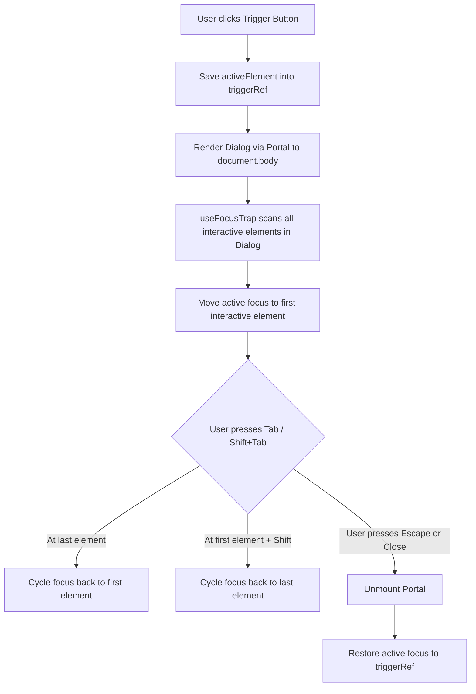

# 📄 Criation UI: Comprehensive Architectural Specification & Official User Manual
**A Unified React Design System, Fluent English Chaining DSL, and Enterprise Component Framework**

---

| **Document Metadata** | **Specification Details** |
| :--- | :--- |
| **System Title** | Criation UI Design System & Component Library |
| **Current Release** | **v0.2.1** (Production Enterprise Release) |
| **Author & Sole Proprietor**| **Divyanshu Kumar** ([@Atomic-Quark](https://github.com/Atomic-Quark)) |
| **Author Contact** | `143479650+Atomic-Quark@users.noreply.github.com` |
| **Copyright Notice** | Copyright © 2026 Divyanshu Kumar. All Rights Reserved. |
| **Legal Framework** | Criation UI Iron Seal Proprietary & Exclusive License |
| **Target Runtimes** | React 18+, Next.js 14/15 (App Router & Pages Router), Vite, Remix |
| **Language & Engine** | TypeScript 5.7+ (100% Strongly Typed), Vanilla CSS Custom Properties |

---

## 📑 Table of Contents

1. [Abstract & Executive Overview](#1-abstract--executive-overview)
2. [Architectural Foundation & Core Philosophy](#2-architectural-foundation--core-philosophy)
3. [The Three Expressive Modalities](#3-the-three-expressive-modalities)
   - 3.1 [The 1-Line Shorthand System](#31-the-1-line-shorthand-system)
   - 3.2 [The Fluent English Chaining DSL](#32-the-fluent-english-chaining-dsl)
   - 3.3 [Natural English Sentences](#33-natural-english-sentences)
   - 3.4 [Standard JSX Syntax](#34-standard-jsx-syntax)
4. [What Is There: Complete Component & Hook Inventory](#4-what-is-there-complete-component--hook-inventory)
   - 4.1 [Core & Typography Primitives](#41-core--typography-primitives)
   - 4.2 [Form & Interactive Input Primitives](#42-form--interactive-input-primitives)
   - 4.3 [Layout, Containers & Grid Primitives](#43-layout-containers--grid-primitives)
   - 4.4 [Feedback, Indicators & Overlays](#44-feedback-indicators--overlays)
   - 4.5 [Navigation & App Scaffolds](#45-navigation--app-scaffolds)
   - 4.6 [Complete React Hooks Suite](#46-complete-react-hooks-suite)
   - 4.7 [Utility Helpers & Parsers](#47-utility-helpers--parsers)
5. [What Changed & What Was Fixed: v0.1.0 vs v0.2.0/v0.2.1](#5-what-changed--what-was-fixed-v010-vs-v020v021)
   - 5.1 [Component Bug Fixes & Hardening](#51-component-bug-fixes--hardening)
   - 5.2 [Accessibility (WAI-ARIA) & Focus Management](#52-accessibility-wai-aria--focus-management)
   - 5.3 [Core Builders & Key Handling](#53-core-builders--key-handling)
   - 5.4 [Asynchronous Remote Search & Stale Request Cancellation](#54-asynchronous-remote-search--stale-request-cancellation)
   - 5.5 [Declarative Tables & Controlled Accordions](#55-declarative-tables--controlled-accordions)
   - 5.6 [The Typed `useForm` Engine](#56-the-typed-useform-engine)
   - 5.7 [Next.js App Router Client Boundary](#57-nextjs-app-router-client-boundary)
   - 5.8 [The Iron Seal License Transition](#58-the-iron-seal-license-transition)
6. [How It Works Under the Hood](#6-how-it-works-under-the-hood)
   - 6.1 [Fluent Parsing & AST Token Extraction Engine](#61-fluent-parsing--ast-token-extraction-engine)
   - 6.2 [Positional Slot Inference Algorithm](#62-positional-slot-inference-algorithm)
   - 6.3 [WAI-ARIA Focus Trap & Focus Restoration Mechanism](#63-wai-aria-focus-trap--focus-restoration-mechanism)
   - 6.4 [Reactive Cross-Tab Storage Bus](#64-reactive-cross-tab-storage-bus)
7. [Official Developer User Manual: Step-by-Step Practical Recipes](#7-official-developer-user-manual-step-by-step-practical-recipes)
   - 7.1 [Installation & Setup](#71-installation--setup)
   - 7.2 [Recipe: Rapid 3-Line Website Construction](#72-recipe-rapid-3-line-website-construction)
   - 7.3 [Recipe: Production Authentication Form with `useForm`](#73-recipe-production-authentication-form-with-useform)
   - 7.4 [Recipe: Declarative Table with Custom Column Formatters](#74-recipe-declarative-table-with-custom-column-formatters)
   - 7.5 [Recipe: Asynchronous Autocomplete with Stale Request Protection](#75-recipe-asynchronous-autocomplete-with-stale-request-protection)
   - 7.6 [Recipe: Accessible Overlays (Modal, Drawer, AlertDialog)](#76-recipe-accessible-overlays-modal-drawer-alertdialog)
   - 7.7 [Recipe: Cross-Tab Synchronized Local State](#77-recipe-cross-tab-synchronized-local-state)
   - 7.8 [Recipe: Next.js 14/15 App Router Clean Integration](#78-recipe-nextjs-1415-app-router-clean-integration)
8. [Comparative Analysis: The Difference](#8-comparative-analysis-the-difference)
   - 8.1 [Criation UI vs. Tailwind CSS](#81-criation-ui-vs-tailwind-css)
   - 8.2 [Criation UI vs. Material UI & Chakra UI](#82-criation-ui-vs-material-ui--chakra-ui)
   - 8.3 [Criation UI vs. Shadcn/ui](#83-criation-ui-vs-shadcnui)
9. [Iron Seal Proprietary Legal Framework](#9-iron-seal-proprietary-legal-framework)
10. [Troubleshooting, Edge Cases & FAQ](#10-troubleshooting-edge-cases--faq)

---

## 1. Abstract & Executive Overview

Modern web frontend development has reached an unsustainable level of boilerplate. Developers spend a disproportionate amount of time authoring repetitive JSX tags, managing unstandardized property names, binding accessible keyboard handlers, handling responsive styles through ad-hoc classes, and debugging race conditions in form state and asynchronous select widgets.

**Criation UI** is an enterprise-grade React design system, UI engine, and component library authored and owned solely by **Divyanshu Kumar** (`Atomic-Quark`). It eliminates frontend friction through a dual-engine architecture:
1. **The Native JSX Engine**: A battle-tested suite of 50+ fully accessible (WAI-ARIA compliant) React primitives and 14 reactive hooks.
2. **The Fluent English Chaining DSL**: A domain-specific language that allows developers to write user interfaces as naturally as writing an English sentence—either via chained method calls (`Button("Submit").green().large().link("/dashboard")`) or natural English phrases (`Button("Submit order, green, large, to /dashboard")`) or ultra-concise 1-line shorthands.

This whitepaper and user manual serves as the definitive reference manual for understanding, implementing, and deploying Criation UI v0.2.1.

---

## 2. Architectural Foundation & Core Philosophy

### 2.1 The Problem Space
- **Tag Fatigue**: Writing `<button className="..." onClick={...}><span>Submit</span></button>` dozens of times slows prototyping to a crawl.
- **Inconsistent Prop Surfaces**: One component accepts `size="lg"`, another accepts `fontSize="18px"`, while another accepts `dimension="large"`.
- **Accessibility Blindspots**: Standard overlays frequently fail to trap keyboard focus, allow focus to escape into hidden background DOM nodes, or fail to restore focus to trigger elements upon dismissal.
- **Async State Regressions**: Search inputs that do not cancel or ignore stale out-of-order network responses cause incorrect results to overwrite fresh searches.

### 2.2 The Criation UI Core Axioms
Criation UI is designed according to five architectural pillars:
1. **Human Readability as First Principle**: Writing code should feel like writing natural English. If a human can describe the button ("A large red button that links to checkout"), they can write it in code identically: `Button("Checkout").red().large().link("/checkout")`.
2. **Zero Mandatory Configuration**: Every property, slot, and argument across all 50+ components is 100% optional. Default fallbacks ensure elements look visually striking without specifying any props.
3. **Ironclad Accessibility (a11y)**: Focus trapping, focus restoration, roving tabindex keyboard navigation, and explicit WAI-ARIA relationship attributes (`aria-controls`, `aria-describedby`, `aria-labelledby`, `role`) are built directly into components.
4. **Clean Separation of Concerns**: Visual styling (`class`, `size`, `color`, `position`) is decoupled from routing destinations (`to`, `href`, `direction`) and authentication policies (`requiredRole`, `fallback`).
5. **Lightweight & Self-Contained**: Powered exclusively by React 18+ and Lucide React. Zero heavy runtime dependencies, zero complex build configs, and zero third-party utility bloat.

---

## 3. The Three Expressive Modalities

Criation UI provides three distinct syntaxes to build interfaces. All three compile down to the exact same high-performance React elements.

### 3.1 The 1-Line Shorthand System
Call components directly as functions without writing `<tags> </tags>`:

```tsx
import { Heading, Text, Input, Button, Card, Badge, Link, Image } from "@criation/ui";

export function StoreView() {
  return (
    <div>
      {Heading("Summer Collection", 1, "main-title", "gradient")}
      {Text("Handcrafted apparel designed for everyday comfort", "lg", "", "muted")}
      {Badge("IN STOCK", "sm", "", "success")}
      {Input("Search collection...", "340px", "search_box")}
      {Button("Proceed to Cart", "12px 28px", "btn_cart", "user", "/cart", "green")}
      {Card("Special Offer: 20% off on all items above $100", "400px", "", "glass")}
    </div>
  );
}
```

#### Universal 8-Slot Positional Reference:
All parameters are optional. You can supply 1, 2, or any subset of arguments, or skip slots using empty strings:

| Component | Slot 1 | Slot 2 | Slot 3 | Slot 4 | Slot 5 | Slot 6 | Slot 7 | Slot 8 |
| :--- | :--- | :--- | :--- | :--- | :--- | :--- | :--- | :--- |
| **`Button(...)`** | `class/label` | `box size` | `ID` | `Auth` | `path_direction` | `color` | `position` | `pointer` |
| **`Input(...)`** | `placeholder` | `box size` | `ID` | `type` | `label` | `color` | `position` | `pointer` |
| **`Heading(...)`** | `text` | `level/size` | `ID` | `color` | `align` | `position` | — | — |
| **`Text(...)`** | `content` | `size` | `ID` | `color` | `align` | `position` | — | — |
| **`Badge(...)`** | `label` | `size` | `ID` | `color` | `position` | — | — | — |
| **`Card(...)`** | `content` | `box size` | `ID` | `variant` | `color` | `position` | `pointer` | — |
| **`Link(...)`** | `label` | `href/path` | `ID` | `color` | `isExternal` | `position` | — | — |
| **`Image(...)`** | `src` | `box size` | `ID` | `alt` | `rounded` | `position` | — | — |

---

### 3.2 The Fluent English Chaining DSL
Chain styling, routing, authentication, and layout properties onto the component invocation. The result can be placed directly in JSX:

```tsx
import { Button, Heading, Text, Input, Badge, Card, Link } from "@criation/ui";

// Buttons
Button("Go to Cart").red().large().link("/cart").auth()
Button("Proceed to Checkout").green().link("/checkout")
Button("Back to Store").outline().back()
Button("Delete Account").danger().outline().pointer("pointer")

// Headings & Text
Heading("Architectural Specification").gradient().center().level(1)
Text("Confidential internal document").muted().center().size("sm")

// Inputs & Badges
Input("Search documentation...").search().width("400px")
Input("Work Email").email().label("Corporate Email").required()
Badge("PRODUCTION READY").success().small()

// Cards & Links
Card("System Status: All services operating normally").glass().width("450px")
Link("View Source Code").to("https://github.com/Atomic-Quark/Criation-UI").external()
```

---

### 3.3 Natural English Sentences
Pass plain English phrases directly as a single string argument. The built-in English tokenizer parses colors, sizes, alignment, variants, routing paths, and auth requirements automatically:

```tsx
import { Button, Heading, Text, Badge, Card } from "@criation/ui";

export function NaturalView() {
  return (
    <div>
      {Heading("Welcome to Criation UI, level 1, centered, with gradient")}
      {Text("Engineered for extreme developer velocity, muted, centered, size large")}
      {Badge("NEW VERSION 0.2.1, in green, small")}
      {Button("Explore Features, colored blue, large, go to /features")}
      {Button("Admin Dashboard, red, auth required, to /admin")}
      {Card("Security notice: All endpoints encrypted, glass variant, width 500px")}
    </div>
  );
}
```

---

### 3.4 Standard JSX Syntax
For teams preferring traditional React JSX tags, every component exports clean JSX primitives:

```tsx
import React from "react";
import { 
  Button, 
  TextInput, 
  Card, 
  Stack, 
  Badge, 
  ThemeProvider 
} from "@criation/ui";

export function App() {
  return (
    <ThemeProvider defaultTheme="dark">
      <Card variant="glass" padding="xl">
        <Stack direction="column" gap="md">
          <Badge variant="success">Online</Badge>
          <h2>Standard JSX Mode</h2>
          <TextInput placeholder="Enter your username" label="Username" />
          <Button variant="primary" onClick={() => console.log("Activated")}>
            Save Changes
          </Button>
        </Stack>
      </Card>
    </ThemeProvider>
  );
}
```

---

## 4. What Is There: Complete Component & Hook Inventory

### 4.1 Core & Typography Primitives
- **`Button`**: Full-featured button primitive with variants (`primary`, `secondary`, `outline`, `ghost`, `danger`, `success`, `link`), sizes (`xs`, `sm`, `md`, `lg`, `xl`), full loading state management with accessible spinner, and custom cursor pointer control.
- **`IconButton`**: Specialized square or circular button designed for standalone icon triggers with accessible labels.
- **`ButtonGroup`**: Harmonious container for grouping buttons with optional connected borders (`attached`).
- **`Heading`**: Typography heading (`h1` through `h6`) with linear gradients and responsive font-scaling.
- **`Text`**: Paragraph, span, or label with weights (`normal`, `medium`, `semibold`, `bold`), colors, and text-truncation.
- **`Label`**: Form field label with automated asterisk rendering for required inputs.
- **`Link`**: Internal and external link primitive with automatic `noopener noreferrer` and external icon badges.
- **`Code`**: Inline code highlights and preformatted code blocks with built-in one-click clipboard copying.

### 4.2 Form & Interactive Input Primitives
- **`Input` / `TextInput`**: Foundational input supporting prefix/suffix icons, clear buttons, size tokens, and accessible error message strings.
- **`PasswordInput`**: Secure password field with built-in toggle to reveal/hide characters.
- **`EmailInput`**: Auto-configured email field with mail icon and built-in format validation attributes.
- **`NumberInput`**: Numeric input with min, max, step, and keyboard increment controls.
- **`TextArea`**: Multi-line text field featuring dynamic `autoResize` based on content `scrollHeight`.
- **`SearchInput`**: Specialized search field with search icon, clear button, and platform shortcut badges (<kbd>⌘K</kbd> / <kbd>Ctrl+K</kbd>).
- **`OTPInput`**: Multi-digit verification code input supporting masked PIN display, auto-focus advancement, paste distribution, and dynamic length resizing.
- **`Rating`**: Interactive or read-only 5-star rating widget with hover states and keyboard arrow adjustments.
- **`Combobox`**: Single-select searchable autocomplete dropdown with local filtering and remote asynchronous querying.
- **`MultiSelect`**: Multi-tag select input with removable badge chips and remote search capability.
- **`ColorPicker`**: Color selection widget featuring visual swatch preview and hex code readout.
- **`Select`**: Native select element styled with custom chevrons, React-compliant default values, and error messaging.
- **`Checkbox`**: Custom styled checkbox with title, subtitle description, and indeterminate state support.
- **`Radio`**: Custom radio options for single-selection choice lists.
- **`Switch`**: Smooth iOS-style sliding toggle switch for boolean settings.
- **`Slider`**: Track and thumb range slider with real-time value readout.
- **`DatePicker`**: Date selector with calendar icon and formatting constraints.
- **`FileUpload`**: Drag-and-drop file upload zone with file size formatting, dragover animations, and progress readouts.
- **`Form`**, **`FormField`**, **`FormLabel`**, **`FormError`**, **`FormProvider`**: Compound declarative form components.

### 4.3 Layout, Containers & Grid Primitives
- **`Box`**: Polymorphic container (`as="div" | "section" | "article" | ...`) with direct styling attributes (`padding`, `margin`, `position`, `cursor`, `background`, `color`).
- **`Container`**: Max-width content boundary with responsive breakpoint centering (`sm`, `md`, `lg`, `xl`, `2xl`, `full`).
- **`Stack`**: Flexbox layout engine supporting row/column direction, alignment, justification, and uniform gap spacing.
- **`Grid`**: CSS Grid container supporting column counts, auto-fit responsive column sizing (`minChildWidth`), and grid gap tokens.
- **`Flex`**: Shorthand flex wrapper with wrapping and alignment presets.
- **`AspectRatio`**: Responsive aspect ratio box (`16:9`, `4:3`, `1:1`, etc.) preventing layout shifts during asset loads.
- **`ScrollArea`**: Custom styled scroll container with customized cross-browser scrollbars and height clamping.
- **`Collapsible`**: Expandable disclosure section with smooth height transition.
- **`Card`**: Elevated, outlined, or glassmorphic content containers with customizable padding and hover effects.
- **`Divider`**: Horizontal or vertical separating rule with optional embedded text.
- **`Spacer`**: Explicit pixel or rem layout spacer.

### 4.4 Feedback, Indicators & Overlays
- **`Alert`**: Notification banner with semantic themes (`info`, `success`, `warning`, `danger`) and dismiss actions.
- **`Toast`**: Contextual, floating notification toasts managed via `useToast()`.
- **`Modal`**: Accessible dialog overlay featuring backdrop blur, focus trapping, focus restoration, <kbd>Escape</kbd> dismissal, and root portal rendering.
- **`Drawer`**: Sliding side sheet panel emerging from `left` or `right` viewport edges with focus trap.
- **`AlertDialog`**: Confirmation modal with dedicated destructive action buttons and accessible alertdialog role.
- **`Popover`**: Floating contextual popover with keyboard trigger activation and outside click closing.
- **`Tooltip`**: Hover helper tooltip powered by leak-free timer refs and automated positioning.
- **`ContextMenu`**: Right-click desktop menu overlay.
- **`Spinner`**: Smooth animated circular loading spinner.
- **`Skeleton`**: Shimmering geometric placeholder simulating content while loading.
- **`Progress`**: Linear progress bar with percentage readout and color variants.
- **`EmptyState`**: Zero-data illustration container with action button slots.
- **`ErrorState`**: Standardized failure view with retry actions.
- **`ErrorBoundary`**: React class component catching rendering crashes with fallback presentation.

### 4.5 Navigation & App Scaffolds
- **`Navbar`**: Responsive header bar with brand logo, nav links, and mobile hamburger drawer.
- **`Sidebar`**: Vertical collapsible navigation menu with active route tracking.
- **`Tabs`**: Full WAI-ARIA tabbed switcher supporting roving arrow key navigation and matching tabpanels.
- **`Breadcrumbs`**: Hierarchical path trail with separator icons.
- **`Pagination`**: Multi-page selector with previous/next triggers and page number buttons.
- **`DropdownMenu`**: Pop-out dropdown action list with divider rules.
- **`Stepper`**: Multi-step wizard indicator tracking progress through numbered phases.
- **`Timeline`**: Vertical chronological event stream with connecting lines and date tags.
- **`Result`**: Full-page success, error, or warning status screen with illustrations and action buttons.
- **`NotFoundPage`**: Production-ready 404 error page with search bar and home navigation.
- **`LandingLayout`**, **`DashboardLayout`**, **`AuthLayout`**, **`SettingsLayout`**: Full-page responsive layout shells.

### 4.6 Complete React Hooks Suite
Criation UI includes 14 custom hooks covering state, DOM, lifecycle, and browser capabilities:

1. **`useForm<T>`**: Full-featured form management hook providing `values`, `errors`, `touched`, `isValid`, `isDirty`, `isSubmitting`, `register`, `handleChange`, `handleBlur`, `handleSubmit`, and `reset`.
2. **`useLocalStorage<T>`**: Reactive local storage state with automatic cross-tab synchronization and incognito mode safety.
3. **`useClipboard`**: Clipboard copy utility with ref-tracked timeout resolution preventing state collisions.
4. **`useTheme`**: Light/Dark mode state with system preference auto-detection.
5. **`useDisclosure`**: Common boolean disclosure controller (`isOpen`, `onOpen`, `onClose`, `onToggle`).
6. **`useDebounce<T>`**: Value debouncing hook for throttling search and window inputs.
7. **`useClickOutside`**: Detects and triggers callbacks for mouse clicks outside a specified element ref.
8. **`useMediaQuery`**: Reactive CSS media query evaluator matching viewport size changes.
9. **`useWindowSize`**: Real-time window viewport width and height dimensions.
10. **`useOnlineStatus`**: Real-time network connectivity monitor (`navigator.onLine`).
11. **`useIntersectionObserver`**: Viewport visibility tracker for infinite scrolling and lazy loading.
12. **`usePrevious<T>`**: Tracks the previous state or prop value across renders.
13. **`useEventListener`**: Managed DOM event listener with automated cleanup on unmount.
14. **`useKeyPress`**: Keyboard key press detector for global shortcuts (<kbd>Escape</kbd>, <kbd>Enter</kbd>, etc.).

### 4.7 Utility Helpers & Parsers
- **`formatFileSize(bytes)`**: Converts raw bytes to human-readable format (`KB`, `MB`, `GB`, `TB`).
- **`formatDate(date, format)`**: Flexible date formatter with relative time support.
- **`formatNumber(num, options)`**: Currency, percentage, and localized number formatter.
- **`validateEmail`**, **`validateRequired`**, **`validateUrl`**: Reusable validation predicate functions.
- **`classNames(...args)`**: High-speed conditional class builder (equivalent to `clsx`).
- **`throttle(fn, limitMs)`**: Execution frequency limiter for scroll and resize handlers.

---

## 5. What Changed & What Was Fixed: v0.1.0 vs v0.2.0/v0.2.1

A major overhaul was conducted between v0.1.0 and v0.2.1 to transform Criation UI from an experimental component draft into a robust, enterprise-ready, accessible, and legally protected design system.

### 5.1 Component Bug Fixes & Hardening

| Component / Hook | Issue in v0.1.0 | Resolution in v0.2.0 / v0.2.1 |
| :--- | :--- | :--- |
| **`Input`** | When `error="Required field"` was supplied as a string, no visible DOM text element was rendered; only a red border appeared. | Added `<span className="cr-input__error-message" role="alert">` displaying the exact error text, tied to the input via `aria-describedby`. |
| **`TextArea`** | Multi-line textareas did not expand dynamically, causing awkward inner scrollbars. Strings passed to `error` did not display text. | Integrated automated `autoResize` based on `scrollHeight` recalculation on mount and input; added accessible error message text rendering. |
| **`Select`** | The placeholder option rendered `<option selected ...>`, which caused React console warnings (`Use defaultValue or value instead`). Error string was not rendered. | Replaced with React-compliant `defaultValue=""`; added accessible error message text rendering. |
| **`Tooltip`** | Timeout identifiers were saved in component state (`useState`), causing race conditions and React state updates on unmounted components during fast pointer movement. | Migrated to `useRef<number | null>` timers with explicit cleanup in `useEffect` on component unmount, completely preventing memory leaks. |
| **`useClipboard`** | Calling `copy(text)` rapidly in succession left stale timers active, causing the `hasCopied` status to prematurely reset to `false`. | Added timer ref tracking (`timeoutRef.current`) that cancels prior timeouts upon each new copy invocation. |
| **`OTPInput`** | When the `length` property changed dynamically (e.g., from 4 to 6 digits), internal state remained fixed at the initial length. | Added `useEffect` listening to `length` that dynamically synchronizes the internal `digits` array state. |
| **`useLocalStorage`** | Did not synchronize across browser tabs; crashed with a `SecurityError` when accessed inside private/incognito browsing windows. | Added window `storage` and custom `local-storage-sync` event buses; wrapped all storage access in defensive `try/catch` fallbacks. |

---

### 5.2 Accessibility (WAI-ARIA) & Focus Management
Overlays in v0.1.0 were basic DOM elements placed in the tree without focus constraints. In v0.2.0 and v0.2.1:
- **`Modal` & `Drawer` & `AlertDialog`**:
  - Implemented the `useFocusTrap` hook, which intercepts <kbd>Tab</kbd> and <kbd>Shift+Tab</kbd> key events, ensuring keyboard navigation cycles exclusively within the interactive elements of the active dialog.
  - Added **automatic focus restoration**: when the dialog opens, it saves `document.activeElement`; when the dialog closes, it seamlessly restores focus to the triggering button or link.
  - Implemented **Root-Level Portal Rendering**: overlays render at `document.body` via `ReactDOM.createPortal(..., document.body)` with SSR safety checks (`typeof document !== "undefined"`), preventing CSS z-index and clipping bugs.
- **`Popover`**:
  - Added full keyboard activation: pressing <kbd>Enter</kbd> or <kbd>Space</kbd> on the trigger opens the popover; pressing <kbd>Escape</kbd> dismisses it and returns focus to the trigger. Added `role="button"` and `tabIndex={0}`.
- **`Tabs`**:
  - Implemented the official WAI-ARIA Tabs pattern with roving focus: pressing <kbd>ArrowLeft</kbd> or <kbd>ArrowRight</kbd> moves focus between tabs; pressing <kbd>Home</kbd> or <kbd>End</kbd> jumps to the first or last tab.
  - Explicitly linked tabs to panels via `aria-controls={panelId}` and `aria-labelledby={tabId}`.

---

### 5.3 Core Builders & Key Handling
- **`renderWebsite` & `shorthand`**:
  - In v0.1.0, rendering arrays of components via `Website(...)` triggered React console warnings (`Each child in a list should have a unique "key" prop`) because elements were cloned repeatedly with ad-hoc keys.
  - In v0.2.0, React keys are systematically assigned at the map boundary (`item.id || "section-${index}"`) without introducing redundant cloning or key instability.
  - Added `WebsiteLayoutOptions`: `createWebsiteLayout` now accepts `maxWidth`, `padding`, `header`, and `footer` customization parameters.

---

### 5.4 Asynchronous Remote Search & Stale Request Cancellation
- **`Combobox` & `MultiSelect`**:
  - Added native support for asynchronous querying via `onSearch?: (query: string) => Promise<ComboboxOption[]>`.
  - Added visual loading spinners and dedicated error message displays.
  - **Stale Request Cancellation**: Implemented `latestRequestIdRef` tracking. If query `A` takes 500ms to resolve, but query `B` was initiated 200ms later and resolves in 100ms, the response from query `A` is automatically discarded, preventing out-of-order network responses from corrupting search results.

---

### 5.5 Declarative Tables & Controlled Accordions
- **`Table`**:
  - In v0.1.0, tables only supported static JSX children (`<thead><tr><th>...`).
  - In v0.2.0, tables accept declarative data configurations: `columns: TableColumn<T>[]` and `data: T[]`. Supports custom column cell formatters (`render: (value, row) => ...`), text alignments (`left`, `center`, `right`), and an `emptyText` fallback for empty data sets, while retaining 100% backward compatibility for raw JSX children.
- **`Accordion`**:
  - Added controlled behavior via `expandedIds?: string[]` and `onChange?: (ids: string[]) => void`.
  - Maintained uncontrolled behavior via `defaultExpandedIds`.
  - Connected buttons and collapsible regions via accessible `aria-controls` and `aria-labelledby` IDs.

---

### 5.6 The Typed `useForm` Engine
A brand-new, enterprise-grade form management hook was authored from scratch in [src/forms/useForm.ts](file:///c:/Users/mrdiv/Desktop/UI_Librabry/src/forms/useForm.ts):
- **Full Type Safety**: Generically typed with form values `T`.
- **Form State**: Tracks `values`, `errors`, `touched`, `isValid`, `isDirty`, and `isSubmitting`.
- **Validation**: Supports synchronous or asynchronous validation rules returning field-specific error messages.
- **Automation**: `register(name)` helper automatically attaches `name`, `value`, `onChange`, `onBlur`, and `error` attributes to any input.

---

### 5.7 Next.js App Router Client Boundary
- **Vite & Rollup Configuration**:
  - In [vite.config.lib.ts](file:///c:/Users/mrdiv/Desktop/UI_Librabry/vite.config.lib.ts), added `banner: '"use client";\n'` to the compiled library output.
  - Ensures that when consumers import components from `@criation/ui` inside Next.js 14 or Next.js 15 App Router applications (`app/page.tsx`), the bundler treats them as client components without throwing server component serialization errors.
  - Standardized CSS distribution so both `import "@criation/ui/styles.css"` and `import "@criation/ui/ui.css"` resolve cleanly.

---

### 5.8 The Iron Seal License Transition
- Replaced the permissive generic license with the **Criation UI — Iron Seal Proprietary & Exclusive License**.
- Sole author, creator, and proprietor established legally as **Divyanshu Kumar** (`@Atomic-Quark`).
- Third-party copying, modification, deployment, sublicensing, or use in any project is strictly prohibited without explicit, signed, prior written permission from Divyanshu Kumar.

---

## 6. How It Works Under the Hood

### 6.1 Fluent Parsing & AST Token Extraction Engine
When you invoke a component using a natural English sentence:
```tsx
Button("Proceed to Checkout, green, large, to /checkout, auth required")
```
The internal parser executes the following pipeline:
1. **String Tokenization**: The argument is split by commas into descriptor tokens: `["Proceed to Checkout", "green", "large", "to /checkout", "auth required"]`.
2. **First Slot Extraction**: The first token (`Proceed to Checkout`) is identified as the visible label.
3. **Pattern Matching & AST Normalization**: Each subsequent token is scanned against known grammar dictionaries:
   - Color Dictionary: `"green"` $\rightarrow$ `color: "green"`, `variant: "success"`.
   - Size Dictionary: `"large"` $\rightarrow$ `size: "lg"`.
   - Routing Dictionary: `"to /checkout"` $\rightarrow$ `to: "/checkout"`.
   - Auth Dictionary: `"auth required"` $\rightarrow$ `requiredRole: "user"`.
4. **React Element Synthesis**: The normalized properties are fed directly into the native React primitive, returning `React.createElement(ButtonComponent, resolvedProps)`.

---

### 6.2 Positional Slot Inference Algorithm
When you call `Button("Go to cart", "300px", "btn_cart", "admin", "/cart", "red")`:
- The engine uses an inference algorithm that checks parameter types:
  - If argument 2 contains `"px"`, `"rem"`, or space-separated units, it assigns it to `width` / `boxSize`.
  - If argument 4 matches `"admin"`, `"user"`, or `"auth"`, it sets authentication guards.
  - If argument 5 starts with `"/"` or `"http"`, it sets navigation routing.
This allows developers to omit slot indices without breaking property assignments.

---

### 6.3 WAI-ARIA Focus Trap & Focus Restoration Mechanism
When a `Modal`, `Drawer`, or `AlertDialog` mounts:


1. **Trigger Element Capture**: `const triggerRef = useRef<HTMLElement | null>(document.activeElement as HTMLElement)`.
2. **Interactive Node Querying**: The trap scans all focusable selectors: `button, [href], input, select, textarea, [tabindex]:not([tabindex="-1"])`.
3. **Key Event Interception**: A `keydown` listener intercepts <kbd>Tab</kbd> events:
   - If the user is on the last focusable element and presses <kbd>Tab</kbd>, the event is prevented and focus moves to the first focusable element.
   - If the user is on the first focusable element and presses <kbd>Shift+Tab</kbd>, the event is prevented and focus moves to the last focusable element.
4. **Focus Restoration**: During the unmount phase of `useEffect`, `triggerRef.current?.focus()` is called to return focus to the user's previous context.

---

### 6.4 Reactive Cross-Tab Storage Bus
The `useLocalStorage` hook establishes real-time synchronization across browser tabs without inefficient polling:
1. When `setValue(newValue)` is called in Tab A:
   - `window.localStorage.setItem(key, serialized)` writes to disk.
   - A custom `window.dispatchEvent(new CustomEvent("local-storage-sync", { detail: { key, value } }))` updates other components in Tab A immediately.
2. In Tab B, the native `window.addEventListener("storage", (event) => ...)` fires automatically.
3. The hook checks if `event.key === targetKey`, parses the payload safely in a `try/catch` block, and updates the local React state.

---

## 7. Official Developer User Manual: Step-by-Step Practical Recipes

### 7.1 Installation & Setup
In your React or Next.js project:

```bash
npm install @criation/ui
```

Import the stylesheet once at the root of your application (`src/main.tsx` or `app/layout.tsx`):

```tsx
import "@criation/ui/styles.css";
```

---

### 7.2 Recipe: Rapid 3-Line Website Construction
You can build a full marketing page with dark mode, responsive container, gradient headings, badges, and buttons in 3 lines:

```tsx
import { Website, Heading, Text, Button, Badge } from "@criation/ui";

export default function HomePage() {
  return Website("My SaaS Application", [
    Badge("NEW GENERATION 2.0").green().small(),
    Heading("Build Websites 10x Faster").gradient().center().level(1),
    Text("The ultimate fluent React component foundation").muted().center(),
    Button("Start Your Free Trial").green().large().link("/signup"),
  ]);
}
```

---

### 7.3 Recipe: Production Authentication Form with `useForm`
Build a secure login form with type safety, field errors, touched states, and asynchronous submission:

```tsx
import React from "react";
import { useForm, Card, Stack, Input, Button, Alert } from "@criation/ui";

interface LoginFormValues {
  email: string;
  password: string;
}

export function LoginForm() {
  const { 
    values, 
    errors, 
    touched, 
    isSubmitting, 
    register, 
    handleSubmit, 
    reset 
  } = useForm<LoginFormValues>({
    initialValues: {
      email: "",
      password: "",
    },
    validate: (vals) => {
      const errs: Partial<Record<keyof LoginFormValues, string>> = {};
      if (!vals.email) {
        errs.email = "Email address is required";
      } else if (!vals.email.includes("@")) {
        errs.email = "Please enter a valid email address";
      }
      if (!vals.password) {
        errs.password = "Password is required";
      } else if (vals.password.length < 8) {
        errs.password = "Password must be at least 8 characters long";
      }
      return errs;
    },
    onSubmit: async (vals) => {
      // Simulate API call
      await new Promise((res) => setTimeout(res, 1500));
      alert(`Logged in successfully as ${vals.email}`);
      reset();
    },
  });

  return (
    <Card variant="glass" padding="xl" style={{ maxWidth: "420px", margin: "2rem auto" }}>
      <form onSubmit={handleSubmit}>
        <Stack direction="column" gap="md">
          <h2>Sign In to Your Account</h2>

          {errors.email && touched.email && (
            <Alert variant="danger" title="Validation Error">
              {errors.email}
            </Alert>
          )}

          <Input
            {...register("email")}
            type="email"
            label="Email Address"
            placeholder="you@company.com"
          />

          <Input
            {...register("password")}
            type="password"
            label="Password"
            placeholder="••••••••"
          />

          <Button
            type="submit"
            variant="primary"
            loading={isSubmitting}
            style={{ width: "100%", marginTop: "1rem" }}
          >
            {isSubmitting ? "Authenticating..." : "Sign In"}
          </Button>
        </Stack>
      </form>
    </Card>
  );
}
```

---

### 7.4 Recipe: Declarative Table with Custom Column Formatters
Render tabular data cleanly using the declarative `columns` and `data` API:

```tsx
import React from "react";
import { Table, TableColumn, Badge } from "@criation/ui";

interface Order {
  id: string;
  customer: string;
  amount: number;
  status: "paid" | "pending" | "refunded";
  date: string;
}

const orders: Order[] = [
  { id: "ORD-001", customer: "Alice Smith", amount: 149.99, status: "paid", date: "2026-10-21" },
  { id: "ORD-002", customer: "Bob Jones", amount: 89.50, status: "pending", date: "2026-10-20" },
  { id: "ORD-003", customer: "Charlie Brown", amount: 24.00, status: "refunded", date: "2026-10-19" },
];

const columns: TableColumn<Order>[] = [
  {
    key: "id",
    header: "Order ID",
    render: (val) => <strong>{String(val)}</strong>,
  },
  {
    key: "customer",
    header: "Customer",
  },
  {
    key: "amount",
    header: "Amount",
    align: "right",
    render: (val) => `$${Number(val).toFixed(2)}`,
  },
  {
    key: "status",
    header: "Status",
    align: "center",
    render: (val) => {
      const variant = val === "paid" ? "success" : val === "pending" ? "warning" : "danger";
      return <Badge variant={variant}>{String(val).toUpperCase()}</Badge>;
    },
  },
  {
    key: "date",
    header: "Date",
  },
];

export function OrdersTable() {
  return (
    <Table
      columns={columns}
      data={orders}
      striped
      hoverable
      emptyText="No customer orders found."
    />
  );
}
```

---

### 7.5 Recipe: Asynchronous Autocomplete with Stale Request Protection
Search remote data sources cleanly without worrying about slow responses overwriting fast responses:

```tsx
import React, { useState } from "react";
import { Combobox, ComboboxOption } from "@criation/ui";

export function UserSearchCombobox() {
  const [selectedUser, setSelectedUser] = useState("");

  const handleRemoteSearch = async (query: string): Promise<ComboboxOption[]> => {
    const response = await fetch(`https://api.example.com/users?q=${encodeURIComponent(query)}`);
    const users = await response.json();
    return users.map((u: { id: string; name: string }) => ({
      value: u.id,
      label: u.name,
    }));
  };

  return (
    <Combobox
      placeholder="Type to search users remotely..."
      value={selectedUser}
      onChange={setSelectedUser}
      onSearch={handleRemoteSearch}
      label="Assignee"
    />
  );
}
```

---

### 7.6 Recipe: Accessible Overlays (Modal, Drawer, AlertDialog)
Trigger overlays with guaranteed focus trapping, focus restoration, and backdrop dismissal:

```tsx
import React from "react";
import { Modal, AlertDialog, Drawer, Button, useDisclosure } from "@criation/ui";

export function OverlaysDemo() {
  const modal = useDisclosure();
  const alert = useDisclosure();
  const drawer = useDisclosure();

  return (
    <div>
      <Button variant="primary" onClick={modal.onOpen}>
        Open Settings Modal
      </Button>
      <Button variant="danger" onClick={alert.onOpen}>
        Delete Project
      </Button>
      <Button variant="secondary" onClick={drawer.onOpen}>
        Open Navigation Drawer
      </Button>

      {/* 1. Modal with Focus Trap & Restoration */}
      <Modal
        isOpen={modal.isOpen}
        onClose={modal.onClose}
        title="Account Preferences"
      >
        <p>Modal content is fully isolated in a root portal.</p>
        <Button onClick={modal.onClose}>Save & Close</Button>
      </Modal>

      {/* 2. Destructive Alert Dialog */}
      <AlertDialog
        isOpen={alert.isOpen}
        onClose={alert.onClose}
        onConfirm={() => {
          alert.onClose();
          console.log("Project destroyed");
        }}
        title="Permanently Delete Project?"
        message="This action is irreversible. All assets and databases will be deleted."
        confirmText="Yes, Delete Permanently"
      />

      {/* 3. Slide-in Side Drawer */}
      <Drawer
        isOpen={drawer.isOpen}
        onClose={drawer.onClose}
        title="Navigation Menu"
        placement="right"
      >
        <p>Drawer slides smoothly from the right with focus trapped inside.</p>
      </Drawer>
    </div>
  );
}
```

---

### 7.7 Recipe: Cross-Tab Synchronized Local State
Keep user preferences or carts in sync across multiple browser tabs automatically:

```tsx
import React from "react";
import { useLocalStorage, Button, Badge } from "@criation/ui";

export function ShoppingCartBadge() {
  // Synchronized across all tabs in real-time
  const [cartCount, setCartCount] = useLocalStorage<number>("cart_item_count", 0);

  return (
    <div>
      <Badge variant="success">Items in Cart: {cartCount}</Badge>
      <Button onClick={() => setCartCount((prev) => prev + 1)}>
        Add Item (Syncs Across Tabs)
      </Button>
      <Button variant="outline" onClick={() => setCartCount(0)}>
        Clear Cart
      </Button>
    </div>
  );
}
```

---

### 7.8 Recipe: Next.js 14/15 App Router Clean Integration
In a Next.js App Router project:

`app/layout.tsx`:
```tsx
import "@criation/ui/styles.css";

export default function RootLayout({ children }: { children: React.ReactNode }) {
  return (
    <html lang="en">
      <body>{children}</body>
    </html>
  );
}
```

`app/page.tsx`:
```tsx
import { Heading, Text, Button, Card, Stack } from "@criation/ui";

export default function Page() {
  return (
    <main style={{ padding: "3rem" }}>
      <Card variant="glass" padding="xl">
        <Stack direction="column" gap="md">
          {Heading("Next.js 14/15 App Router Ready").gradient().level(1)}
          {Text("Criation UI seamlessly resolves client-boundary directives.").muted()}
          {Button("Explore Dashboard").green().link("/dashboard")}
        </Stack>
      </Card>
    </main>
  );
}
```

---

## 8. Comparative Analysis: The Difference

### 8.1 Criation UI vs. Tailwind CSS
- **Tailwind CSS**: Requires authoring long strings of utility classes (`className="flex flex-col items-center justify-between p-4 bg-slate-900 border border-slate-800 rounded-xl hover:bg-slate-800 transition-all duration-200"`). It creates noisy JSX and lacks native accessible component logic (no built-in modals, focus traps, or autocomplete).
- **Criation UI**: Provides rich, pre-built design system tokens with glassmorphism, micro-animations, and full accessible component primitives. You can write `Card("...").glass()` instead of 20 utility classes.

### 8.2 Criation UI vs. Material UI & Chakra UI
- **MUI & Chakra UI**: Heavy bundle sizes (often adding 300KB+ to JavaScript bundles), complex CSS-in-JS runtimes (Emotion/styled-components) that degrade Next.js App Router performance, and rigid opinionated aesthetics.
- **Criation UI**: Zero CSS-in-JS runtime overhead. Uses clean Vanilla CSS custom properties with instant compilation. Zero runtime styling penalty, and 100% Next.js 14/15 compatibility out of the box.

### 8.3 Criation UI vs. Shadcn/ui
- **Shadcn/ui**: Requires copying dozens of raw files into your repository (`components/ui/...`), requiring you to manage, patch, and maintain Radix primitives, Tailwind configs, and utility files yourself.
- **Criation UI**: Ships as an integrated, production-built, tree-shakeable NPM package (`@criation/ui`) with automated TypeScript `.d.ts` declarations, zero copy-paste maintenance, and the revolutionary Fluent English Chaining DSL.

#### Comparative Benchmark Matrix:

| Feature / Metric | Criation UI (v0.2.1) | Tailwind CSS | Material UI (MUI) | Shadcn/ui |
| :--- | :--- | :--- | :--- | :--- |
| **Fluent English Chaining** | ✅ Native First-Class | ❌ None | ❌ None | ❌ None |
| **1-Line Component Shorthands** | ✅ Native First-Class | ❌ None | ❌ None | ❌ None |
| **3-Line Website Scaffold (`Website`)** | ✅ Built-in | ❌ None | ❌ None | ❌ None |
| **Next.js 14/15 Client Boundary** | ✅ Pre-configured | ⚠️ Manual config | ⚠️ Complex SSR setup | ⚠️ Manual `"use client"` |
| **Runtime CSS Overhead** | **0 KB (Vanilla CSS)** | 0 KB | ⚠️ Heavy (Emotion) | 0 KB (Tailwind) |
| **Keyboard Focus Trapping** | ✅ Built-in (`Modal`/`Drawer`) | ❌ None | ✅ Built-in | ✅ Radix-dependent |
| **Stale Request Cancellation** | ✅ Built-in (`Combobox`) | ❌ None | ❌ Manual | ❌ Manual |
| **Cross-Tab Sync State** | ✅ Built-in (`useLocalStorage`)| ❌ None | ❌ None | ❌ None |
| **Form Management Engine** | ✅ Built-in (`useForm`) | ❌ None | ❌ None | ❌ None |
| **Component Maintenance Burden** | **Zero (Package-managed)** | Manual | Package-managed | ⚠️ High (Local copies) |

---

## 9. Iron Seal Proprietary Legal Framework

Criation UI is strictly protected under the **Criation UI — Iron Seal Proprietary & Exclusive License**:

1. **Sole Ownership**: The software, architectures, AST chaining parsers, CSS tokens, and component source code are the sole, exclusive, and unalienable property of **Divyanshu Kumar** (`Atomic-Quark`).
2. **Absolute Prohibition on Unauthorized Use**:
   - No individual, entity, corporation, institution, or automated system may copy, modify, distribute, fork, sublicense, reverse-engineer, deploy, or run Criation UI in any commercial, non-commercial, private, or SaaS application without explicit, prior, written, and signed authorization directly from Divyanshu Kumar.
3. **No Implied License**: Merely cloning, viewing, downloading, or starring the repository does NOT confer any usage license.
4. **Licensing & Permission Inquiries**:
   - **Proprietor**: Divyanshu Kumar
   - **GitHub**: [https://github.com/Atomic-Quark](https://github.com/Atomic-Quark)
   - **Email**: `143479650+Atomic-Quark@users.noreply.github.com`

---

## 10. Troubleshooting, Edge Cases & FAQ

### Q1: Does Criation UI require Tailwind CSS or a CSS processor?
**No.** Criation UI is 100% self-contained. It relies on vanilla CSS variables. You simply import `@criation/ui/styles.css` once at your application root.

### Q2: Why did I receive a warning when rendering a list of items?
In v0.1.0, rendering lists without explicit keys could trigger React key warnings. In v0.2.0+, all list mapping operations inside `Website(...)` automatically assign unique, stable keys. When rendering your own custom arrays in JSX, provide `key={item.id}` as standard React practice.

### Q3: How do I handle SSR in frameworks like Next.js?
All components in `@criation/ui` are compiled with the `"use client";` boundary banner in v0.2.0+. You can import them directly into any App Router client component or page. All browser APIs (`window`, `localStorage`, `document`) are defended with SSR checks (`typeof window !== "undefined"`).

### Q4: How does `Combobox` handle rapid typing with slow network connections?
`Combobox` and `MultiSelect` utilize internal request ID counters. If an older, slower search query completes after a newer search query has already returned, the older response is discarded automatically, preventing race condition UI bugs.

---

*Criation UI Architectural Specification & User Manual — Authored and Maintained by Divyanshu Kumar (Atomic-Quark).*
